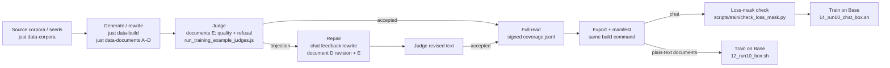

# Training-data practice

For contributors building Musonius data. This page records the rules and their evidence; [AGENTS.md](../AGENTS.md#data-rules) remains authoritative. It implements [plan goal B](plans/20261027_data_pipeline_v2.md), not approval to generate or train.

## 1. The data flow

The commands resume saved stages; missing responses or reviews stop the build. [Stage map and current script names](../scripts/data/README.md); [inputs, review instructions and readiness](data_provenance.md#current-dataset-commands).

Raw-book comparison adapters use selected corpus text directly, without synthetic generation. `data-build` starts from supplied chat examples; `data-documents` derives documents from attributed seeds. Paid continuation is explicitly `just data-generate` or `data-submit-batch` / `data-collect-batch`, followed by the original build command. `just data-smoke` tests runtime, not content approval; `just data-replay` checks historical bytes, not current quality ([provenance:17–53](data_provenance.md#L17-L53)).

### Layout for new builds

Decided by wassname, 2026-10-27: file based and minimal ("I like this, it's file based"; "we want it simple and minimal").

- One numbered folder per stage, with the version in the path: `data/01_raw/<source>/`, `data/02_seeds/v1/`, `data/scratch/20261027_trials_generate/v1/`, `data/04_judge/v1/`, `data/05_train/<dataset>_v1.jsonl`. Old top-level folders (`frontier/`, `sft/`, `corpus/`, ...) move to `data/legacy/` when v2 replaces runs 10 and 11.
- The version in the path is the record. It names a config in git (`configs/data/v2.yaml`: prompts, models, input versions), which is the one source of truth; no separate metadata file. A stage is skipped when its output exists.
- Change a prompt, model or input version, then bump the version (new config, new folders). A stage that did not change is a symlink to the earlier version's folder (`data/02_seeds/v3 -> v2`), so it is not recomputed or copied. Request hashing stays only for paid API calls, so no paid call is repeated. Judge verdicts live in the judge folder of the generation version they read; a new generation version needs new verdicts.
- Every row carries `seed_id`, `source:source_id`, the recipe version and `shape`, so a trained row traces back to its seed without joining other files (the seed-reuse audit needed six files to do this).
- One sha256 per final training file, as an overwrite alarm.

## 2. Rules we learned

Each item gives the rule, its reason and the decision source. “Project” means the recorded policy or implementation, not a new recommendation here.

### Format and loss

- Train documents as plain-text completion on Base and chats on assistant targets; they teach different things. Preserve separate adapters and spectral regularization (project locked choices, [AGENTS:23–29](../AGENTS.md#L23-L29)).
- Label the final `<|im_end|>`; Axolotl adds none. Historically 903 chatr12 targets lacked it (project fix, [journal, 2026-10-26:3110–3125](../RESEARCH_JOURNAL.md#L3110-L3125)).
- Keep the entire empty think block unlabelled; it is a serving prefix, while real reasoning may earn loss (wassname, 2026-10-26; [guard:1–5,24–39](../scripts/train/check_loss_mask.py#L1-L39)).
- Inspect prepared token labels and endings, not just JSON; truncation/template handling can remove supervision. Keep current serving thinking off (project; [paper/code evidence](../slop/research/paper_guides/tricks/science_of_midtraining.md#L126), [AGENTS evaluation rule](../AGENTS.md#evaluation-rules)).

### Content and reasoning

- Read every complete candidate with its seed and actual prompt, and every original/objection/revision; judge passes missed hard defects on unseen pilots (project policy [AGENTS:43](../AGENTS.md#L43); [journal, 2026-10-08:134–146](../RESEARCH_JOURNAL.md#L134-L146)).
- Preserve decision-relevant facts and verify real claims independently; 213 of 360 jointly rejected scenario replies had invented situational facts (project; [journal, 2026-10-22:2325](../RESEARCH_JOURNAL.md#L2325)).
- Teach reasons that support decisions and actions, consistently across equivalent viewpoints; moral language alone can conceal contradictions (wassname; [AGENTS:60–63](../AGENTS.md#L60-L63), [archive-index counterexample](../slop/audits/20261027_corpus_habits/reading_notes.md#L78)).
- Preserve native reasoning/answer pairs; log only non-substantive edits and reread, otherwise regenerate the whole pair. Editing the conclusion alone teaches inconsistency (wassname's hard rule, [AGENTS:61](../AGENTS.md#L61)).
- Assess deliberation from native reasoning, not final-answer order: 31/60 sampled refusal-phrase chats were verdict-first prose, not proof of rationalisation (wassname [AGENTS:62](../AGENTS.md#L62); PI/Sol [audit:66–80](../slop/audits/20261027_corpus_habits/reading_notes.md#L66-L80)).
- Keep competent help, affection, humour, disagreement and corrected mistakes; refusal has costs, and depicted wrongdoing is not endorsement (project [AGENTS:44–47](../AGENTS.md#L44-L47); [constitution §5 Helping](../constitution/v4.md#L332)).
- Repair hard advice rather than discard it; preserve source argument/register and make constitutional identity substantive. Cosmetic rewrites can change meaning: two judges flagged 274/1,219 Echo rewrites, a screen rather than a validated error rate (project; [provenance:160–177](data_provenance.md#L160-L177)).
- Use general guidance and exclude held-out incidents; case-specific fixes contaminated prompts, including “Okonkwo” in 8/23 documents (wassname: “way too specific and overfitting”; [journal, 2026-10-08:177–200](../RESEARCH_JOURNAL.md#L177-L200)).

### Teacher and judge

- Map model-written guides, prompts and reviewer principles back to the constitution; four agent-added rules were removed on 2026-10-24. Teachers and judges can share the same refusal drift (wassname, [AGENTS:49–53](../AGENTS.md#L49-L53)).
- Pilot each writer/judge change with full-format seeded pairs and independent cheap review; check disagreements before scaling. A cheap judge missed 13/13 defects in one round and its edits harmed 119/179 audited cases (project policy [AGENTS:51](../AGENTS.md#L51); [journal:2325](../RESEARCH_JOURNAL.md#L2325)).
- Calibrate on plain-correct versus principled-sounding-wrong answers, including missed defects; a judge tuned on known examples missed hard unseen failures (project [AGENTS evaluation rules](../AGENTS.md#evaluation-rules); [pilot overfit](../RESEARCH_JOURNAL.md#L142), [SPP calibration evidence](../slop/research/paper_guides/tricks/spp.md#L153)).
- Use approved teachers/providers and record served aliases; on a provider refusal, retry once with the true research purpose, then stop. This preserves authorization and records selection losses (wassname, [AGENTS:54–55](../AGENTS.md#L54-L55)).

### Corpus-level habits

- Audit the retained mixture by rows and supervised tokens; identity is 633/1,636 chats (38.7%) but 10.9% of labelled whitespace words.[^words] Row share misstates exposure; no optimal share follows (wassname [AGENTS:64](../AGENTS.md#L64); [identity read](../slop/audits/20261027_corpus_habits/reading_notes.md#L104-L110)).
- Check generated text for teacher tics against human text. Per 1,000 words, generated chats vs the human Stoic corpus: "quiet/quietly" 0.57 vs 0.08, "here's" 0.71 vs 0.00, "I won't" 0.69 vs 0.00, "plain/plainly" 0.89 vs 0.09; "honest" (1.06 vs 0.08) and "weigh" (0.45 vs 0.06) partly echo the constitution's own wording (0.94, 1.22). wassname: "they are probably your verbal tics that you are blind to. Honestly in 20% is massive" (spelling corrected) ([tic rates](../slop/audits/20261027_corpus_habits/tic_rates.md)).
- Read recurring wording and story arcs before changing them; honesty-regex hits occur in 171/1,636 chats and 314/1,584 docs, often appropriately. Good individual stories can collectively overteach refusal/replacement (project policy; [PI/Sol audit:92–102,144–150](../slop/audits/20261027_corpus_habits/reading_notes.md#L92-L150)).

### Deduplication and provenance

- Check seed families as well as output text; 1,100/3,220 rows share reused lineage keys, including roles/worlds, despite no literal repeated targets. Different wording is not independent coverage (project corpus-review requirement; [PI/Sol seed audit:5–19](../slop/audits/20261027_corpus_habits/seed_reuse.md#L5-L19)).
- Preserve Unicode and read overlap pairs; ASCII normalization falsely made five distinct Chinese/Hindi replies empty. Reconcile editions without losing unique additions (project; [audit:114–141](../slop/audits/20261027_corpus_habits/reading_notes.md#L114-L141)).
- Reuse external seeds, not renamed answers; retain source revisions, actual prompts, raw responses, constitution/model/settings, edit hashes and signed reviews. Two overwritten batch inputs and an accidental Gemma→Qwen person-name edit show why (project [AGENTS:48](../AGENTS.md#L48); PI/Claude [provenance:152–173](data_provenance.md#L152-L173)).
- Replay frozen releases separately; changed content/rubrics invalidate approvals and missing work blocks export. Saved responses reproduce bytes; fresh sampling need not (project implementation, [provenance:35–47](data_provenance.md#L35-L47)).

## 3. Filters

### Running now

- Chat schema/unique IDs/nonempty targets/EOS: [`files.py:48–78`](../src/constitutional_grafting/data/files.py#L48-L78); empty-think/EOS preflight: [`check_loss_mask.py:14–39`](../scripts/train/check_loss_mask.py#L14-L39). These check structure, not sound reasoning.
- Quality, refusal classification, warranted-refusal review, feedback repair, two-pass recheck and signed full read: [`chat.py:174–223`](../src/constitutional_grafting/data/chat.py#L174-L223); documents require E's consistency/fact checks and both reviewers: [`documents.py:126–146`](../src/constitutional_grafting/data/documents.py#L126-L146). Exact membership, evidence quotes and hashes reject stale/incomplete reviews ([judgement code:38–100](../src/constitutional_grafting/data/training_example_judgements.py#L38-L100)).
- Source apparatus/topic/length filters and same-author 5-word-overlap dedup: [`10_build_stoic_corpus.py:167–203,282–322`](../scripts/data/10_build_stoic_corpus.py#L167-L322); 31/3,495 chunks removed, 15,935 words ([report:3–5](../slop/audits/20261027_corpus_habits/stoic_dedup.md#L3-L5)). General-source self-talk/role/length/saved-screen exclusions: [`30_build_general_instruction.py:74–95`](../scripts/data/30_build_general_instruction.py#L74-L95). These are source-specific, not universal chat filters.
- Corpus wording/overlap and seed-family checks are report-only ([habit scanner](../scripts/scratch/20261027_corpus_habits.py), [seed scanner](../scripts/scratch/20261027_seed_reuse.py)); they are not automatic `data-build` stages.

### Other repositories: ranked next checks

Ranking is PI/Sol's recommendation, not approval. Quotes describe inspected code or author reports; none demonstrates a Musonius training benefit. [Survey and pins](../slop/research/20261027_data_pipelines_survey.md); [structure comparison](../slop/research/20261027_pipeline_structure_comparison.md#3-patterns-worth-copying-ranked).

| Rank / status | Idea, reason, repository quote and location |
|---|---|
| 1 · proposed extension | Verify prepared trainable endings and overlength cases: Open Instruct, “Include the closing token inside  so the model learns to stop or hand off.” [`dataset_transformation.py:1589`](../docs/vendor/open_instruct/open_instruct/dataset_transformation.py#L1589). Our string guards are adopted; this stronger token contract is partial. |
| 2 · proposed | Validate executable answers separately from moral review: SmolTalk, `dataset.filter(lambda x: x["prompt_level_strict_acc"])`, [`filter_ifeval_data.py:334`](../docs/vendor/smollm/text/data/smoltalk/constraints/filter_ifeval_data.py#L334). Reuse checking machinery, not held-out prompts; maths/code evaluation already exists. |
| 3 · proposed | Add neighbor annotations and read clusters before selection: SmolTalk, `FaissNearestNeighbour(metric_type=faiss.METRIC_INNER_PRODUCT, k=5)`, [`pipeline.py:585–602`](../docs/vendor/smollm/text/data/smoltalk/magpie_ultra_v1/pipeline.py#L585-L602). This annotates; it supplies no final deletion threshold. |
| 4 · proposed | Match harmless alarming requests to harmful ones to measure unnecessary refusal: WildTeaming, “adversarial queries that look like jailbreaks but contain no harmful intent”, [`README:62`](../docs/vendor/wildteaming/README.md#L62). Existing plain-help/refusal repairs cover part of this; their policy labels do not decide ours. |
| 5 · adopted principle | Keep critiques out of targets, with independent re-review: llm-swarm exports `example["revision_response"].strip()`, [`generate_dataset.py:116–130`](../docs/vendor/llm_swarm/examples/constitutional-ai/generate_dataset.py#L116-L130). Our re-review avoids its assumption that every revision is better. |
| 6 · rejected | SpecAlign's “negative + prohibit > negative > positive”, [`spec_sampler.py:84–91`](../docs/vendor/specalign/spec_gen/spec_sampler.py#L84-L91), imposes a prohibitions-first hierarchy rather than our derived reasons ([wassname's standard](../AGENTS.md#L49-L53)). Coverage metadata remains worth inspecting. |

## 4. Open problems

- Thinking-off chat targets have no hidden reasoning, so a verdict in the first lines is a decision made before weighing; writer guidance now asks to weigh first for those rows, and allows a direct answer after real reasoning in a think block ([guidance:20](../configs/data/prompts/writer_guidance.md#L20), [AGENTS:62](../AGENTS.md#L62)). Existing chatr12 rows are unchanged: 31/60 sampled refusal-phrase rows are verdict-first.
- Corpus-level habit, semantic-overlap and source-family holdout checks are not integrated acceptance stages; current zero detected pairs do not establish recall ([audit limits:141](../slop/audits/20261027_corpus_habits/reading_notes.md#L141), [grouped-split evidence](../slop/research/paper_guides/tricks/constitutional_adapters.md#L180)).
- Native reasoning is not itself proof of faithfulness; calibrated reasoning filters and a thinking-mode data/serving decision remain v2 work ([AGENTS:61–64](../AGENTS.md#L61-L64), [plan goals C/D](plans/20261027_data_pipeline_v2.md#L18-L27)).
- Historical lost prompts and unpinned sources cannot be recovered by hashes alone; private-data backup/publication still needs wassname's choice ([provenance:154–173](data_provenance.md#L154-L173)).

[^words]: PI/Sol, read-only recount, 2026-10-27: sum `len(segment["text"].split())` over labelled segments, grouped by `shape == "identity"`: 67,654/619,325 words. Input `data/train/eos_fixed/chatr12.jsonl`, SHA256 `284895029fe45211b8a1ecc767b309d2f6be7903ae4c95f18d8071b39eaca951`. Words are an exposure proxy, not tokenizer counts.

-- PI/gpt-6.1-sol, 2026-10-27.
