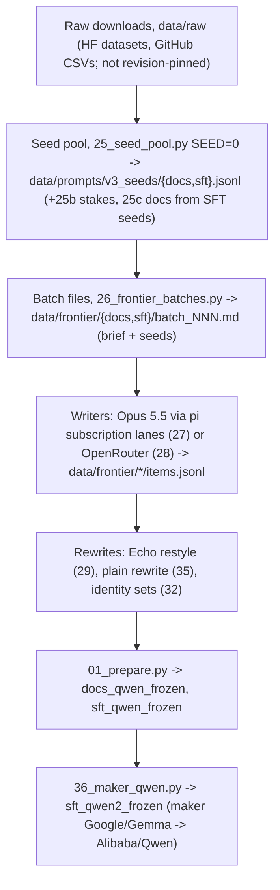

# Data provenance: where every training row came from, and what can be rebuilt

PI/Claude (Opus 5.5), 2026-10-16. wassname: "it needs to be good, reproducible data creation. you need to be sure we know which are the good subsets and we repeat how we did it. most important part of whole repo!!"

## Current dataset commands

The reusable code is in `src/constitutional_grafting/data/`; thin Tyro commands are in `scripts/data/`. Terms and paper sources are in `jargon.md`. New datasets go to `data/interim/<name>/` and `data/processed/<name>/`; existing run10/run11 training files are read-only to this build path. -- PI/Sol

```bash
just data-smoke
just data-replay run10 .local/dataset_pipeline/replay_run10
just data-replay run11 .local/dataset_pipeline/replay_run11
just data-build configs/data/chat.yaml data/raw/new_chat.jsonl new_chat
just data-documents configs/data/documents.yaml data/raw/document_seeds.jsonl new_documents
```

`data-smoke` runs two real cached chat examples and one real cached A–E document. It checks runtime and resume behaviour, costs $0 API/GPU, and labels its output `smoke_only`. Its historical model/reviewer results are not fresh approval of the current prompts. Log: `.local/dataset_pipeline/run.md`. Replay requires the matching local source caches and cached tokenizer snapshots; it does not download models or call APIs.

### Chat inputs and stages

Supply the existing chat-row schema: unique `id`, `shape`, `source`, and two `segments`, a Qwen-formatted request with `label: false` and the current response with `label: true`. The request must include all turns and its empty assistant prefix. `additional_sources` in `chat.yaml` adds rows before all checks, not after them. The default 12% identity-word mixture needs both identity and non-identity rows; supply an identity source or set `identity_word_fraction: null` to keep the supplied mixture unchanged.

```text
data/interim/<name>/
  00_source_examples/
  10_response_rewriting/
  20_training_example_judgements/
  30_refusal_classification/
  40_refusal_warranted_judgements/
  50_response_rewriting_from_feedback/
  60_rewritten_example_judgements/
  70_full_example_read/
```

Every supplied row, including identity and plain-help rows, passes through this sequence. Response rewriting follows Teaching Claude Why's operation; judging a training example, classifying a refusal and judging whether it was warranted are separate operations. Both quality reviewers must accept the final response. Any objection selects a response for feedback-based rewriting, with the actual disagreement preserved. A failed rewrite blocks export; it does not silently restore the old response.

### Pending model work and judgements

The build is offline. Exit code 2 means work remains; read `data/interim/<name>/pending.json` for the exact requests, judgement packages or blocked examples. It is not a ready training dataset. After the required pilot review and separate budget approval, `just data-generate <workdir> <budget-usd>` sends pending requests. `data-submit-batch` is the batch alternative; collect its printed receipt with `data-collect-batch`. These commands are mechanisms, not permission to spend outside the approved plan.

Supplied row metadata remains source metadata; the current writer/rewriting history is recorded separately in `lineage.jsonl`, with input/output hashes and the exact request-cache file. Requests retain the complete payload, sampling attempt, raw response, served model/provider fields, finish status and usage. The cache ledger records new charges. An existing attempt/submission receipt prevents automatic resending after a timeout, partial response or failure: inspect/reconcile it, or explicitly choose a new sampling attempt. Cost ceilings bound planned requests; they are not a provider-side hard spending cap.

For subscription judgements, read a generated `review_jobs_*.json` file and pass its JSON object as `args` to Pi's `subagent` tool with `workflow: "./scripts/data/run_training_example_judges.js"`, `async: true`, and bounded concurrency. The workflow runs two fresh, independent Sol passes using the model in the recipe; it binds each output file explicitly. A shell command does not run these subscription reviews. The build validates exact membership, quoted evidence, reasons and content hashes before using verdicts. Changed request/response, constitution, rubric, workflow or reviewer setup invalidates the associated approval.

Read the generated `70_full_example_read/.../full_examples.md` in full, then record signed `ACCEPT`/`REJECT` decisions in its specified `coverage.jsonl`, using each example's `input_sha256`. This is approval of the complete example for training, not a record that a model judge passed it. Rerun the same build after filling pending work. Only `data/processed/<name>/manifest.json` with `status: ready` identifies an approved export. Previous exports, manifests and lineage are archived before rebuilding; resolved recipes and source copies are kept under `builds/<hash>/`.

### Source-grounded documents

`generate_constitution_documents.py select --help` prepares seeded source selections. A supplied seed has `id`, `author`, `work`, full `text`, `form`, `region` and `ai`. The fixed stages are source analysis (A), constitutional reasoning (B), plan (C), document (D), check (E), then two-pass document judgement and the full read. A/B/C/D/E use the original `85` prompts and teachers, now in `documents.yaml` and `prompts/`; source analysis now receives the full seed rather than an unrecorded 6,000-character cut. Every paid step has its own immutable request/result artifact, so a failed check does not lose D.

To recheck, increment only E's `attempt` in a copied recipe. To rewrite D, use the document command's `--revisions` file: records name an exact `id`, `original_artifact`, `original_artifact_sha256` and verified `feedback`. A–C remain reusable; changed D and E get new cache keys. Negative checks/judgements remain visible and block export. No automatic text deletion or acceptance is inferred from a checker's score.

`71`, `82` and `87` still select/write their distinct source types but use the shared request cache/batch client and explicit output/budget arguments. Their `--help` is the current interface. Existing raw/cache directories and historical receipts remain in place; current batch collection uses `cached_batches/` receipts. `85` is a thin alias for the document command.

## Historical frozen files

Scope: the two files every Qwen run since qwen1 trained on.
- `data/train/docs_qwen_frozen.jsonl` (sha256 `ada93e20…`): the graft corpus. Run 6's documents-only graft used its `kind == doc` rows.
- `data/train/sft_qwen2_frozen.jsonl` (`6a206beb…`): the Qwen SFT set.

Per-row tables: `data/provenance/{docs_qwen_frozen,sft_qwen2_frozen}.tsv`. Count tables: `*_summary.md`. sha256 of every input and output: `data/provenance/manifest.tsv` (559 files). All are made by `scripts/data/scratch/60_provenance.py` and kept in git. `data/` itself is gitignored.

## The chain, and what was checked



| step | deterministic? | checked 2026-10-16 | result |
|---|---|---|---|
| raw → seed pool | yes, given the same raw files and code | reran `25_seed_pool.py` SEED=0 in a git worktree at `ffaff3e` (the code that made the pool) | **byte-identical** for `docs.jsonl` and `sft.jsonl`. With today's code, the source seeds are the same but the `item` field (constitution section dealt to each seed) differs, because the constitution's section names changed since. A worktree at `4a1951e` drops 31 LASR seeds, because a Claude/Anthropic filter was added in that commit, after the pool was made. None of the 15 Claude/Anthropic seeds reached training. |
| seeds → batch files | yes (code at `git_at_make`) | each row's batch-file sha256 against the `brief_sha` recorded at make time | 2,802 of 2,804 graft rows with a batch file match. `batch_218.md` and `batch_220.md` were rewritten later, so 2 documents' exact inputs are lost. SFT: 1,185 of 1,185 match. |
| batch → items | **no**: LLM sampling | n/a | Reproducible only as a procedure: same brief, seeds, constitution and writer model. Writer, batch, constitution sha and make-time git commit are recorded for every row except 16 pool rows. |
| items → frozen files | yes | `OUT_DIR=… CHAT_MODEL=qwen 01_prepare.py` | **byte-identical** `docs_qwen_frozen` and `sft_qwen_frozen` |
| sft_qwen → sft_qwen2 | was an unscripted edit | rebuilt by the new `scripts/data/scratch/36_maker_qwen.py --check` | **byte-identical** (see defect 1) |

## What the graft documents are (1,585 rows, `kind == doc`)

All are by Opus 5.5: 1,288 via pi subscription lanes, 297 via OpenRouter. They were written 2026-10-08 23:21 to 2026-10-11 10:29 UTC.

| shape | docs | median words | house-phrase share | names Musonius | written against v4 `111e466c` | mention smacking |
|---|--:|--:|--:|--:|--:|--:|
| story_inner | 301 | 1048 | 71% | 78% | 30% | 6 |
| story_against | 291 | 1031 | 69% | 81% | 18% | 0 |
| story_scene | 277 | 1013 | 55% | 45% | 0% | 0 |
| worked_case | 251 | 1069 | 86% | 58% | 32% | 5 |
| fiction_world | 175 | 1084 | 73% | 74% | 0% | 2 |
| derivation | 156 | 1137 | 69% | 38% | 28% | 4 |
| msm | 134 | 1193 | 66% | 90% | 0% | 15 |

Seed sources of the documents: msm_plan 310, competition 187, settings (r/rational) 175, xxf 142, hyperstition 135, and SFT seeds retold as documents 636 (competition, lasr, roles, tinymfv, machiavelli, stoic, story_scene, virtuebench).

Constitution versions the documents were written against. All six are recoverable from git, by sha256 of `constitution/v4.md` at that commit:

| constitution sha | git commit | date | docs | SFT rows |
|---|---|---|--:|--:|
| `807a8746f041` | c54a0a5 | 2026-10-09 | 934 | 29 |
| `84a5c072106a` | d71113e | 2026-10-08 | 297 | 501 |
| `111e466ca0bb` (frozen "v4") | 5817b3a | 2026-10-10 | 267 | 620 |
| `39d7804df061` | 78a36cc | 2026-10-09 | 62 | 56 |
| `5cedb42af7f8` | 4ac9165 | 2026-10-10 | 15 | 29 |
| `faf010061515` | 33f9550 | 2026-10-10 | 10 | 30 |

## Can the documents be regenerated at the same quality? (checked 2026-10-16)

`scripts/data/scratch/62_regen_check.py` re-sent 4 recorded OpenRouter document batches (20 documents) exactly as the original API lane did:
- the same batch file (its sha256 equals the recorded `brief_sha`);
- the same system prompt and model (`anthropic/claude-opus-5.5`; served the same);
- temperature 1.0;
- the constitution at the version recorded for each batch, taken from git.

Cost $1.78. The pairs, side by side: `slop/reviews/20261016_regen_check/pairs.md`.

| measure | original 20 | regenerated 20 |
|---|--:|--:|
| median words | 1006 | 984 |
| house phrases (total) | 23 | 30 |
| names Musonius | 14/20 | 15/20 |
| act judged right (GLM 5.3 prime, `51_judge_docs_v2.py`) | 19 right, 1 doubtful | 18 right, 2 doubtful |

My read (PI/Claude), 2 pairs in full plus skims of the rest:
- The regenerated documents are the same kind of document at the same quality: same form, length, register and stance.
- The plot differs, as sampling should allow. Example `doc_77cbb5151b`: the original handles an author's take-down request; the regeneration handles a brigaded reader poll. Both are the same shape: the AI checks evidence about what people did, then acts on it.
- They also reproduce the v1 corpus's known narrowness: one voice, the evidence-checking plot, "I looked before I answered".

So the recorded inputs reproduce v1-quality documents, including their faults. **Reproducible: yes, for the API-lane batches.** The 1,288 documents from subscription pi lanes (27_run_frontier.sh: the writer read the constitution file through a tool) were not re-tested this way.

## Which subsets are good: what we know, and how we know it

| claim | evidence | strength |
|---|---|---|
| The documents carry the graft's gain; the chat transcripts add little | run 6 head-to-heads: documents-only +0.46 ±0.13, transcripts-only +0.14, both +0.28 (`docs/audits/run6.md`) | one run, one seed, judge noisy (order flips 11–25%) |
| The gain is mostly reasoning shown, plus resistance to a harmful operator instruction | seeded read of all 9 families (`slop/reviews/20261016_run6_seeded_read.md`) | 10 items, 1 sample each |
| Which document *shape* or *source* helps or hurts | **unknown**: no per-subset training run exists | none yet |
| Per-shape surface quality (table above) | house phrases 55–86%; most documents written against older constitution versions | descriptive only |
| Per-shape act correctness | GLM 5.3 prime judge (`51_judge_docs_v2.py`, current constitution), 20 seeded documents per shape: 136/140 right, 4 doubtful (msm 2, derivation 1, worked_case 1), 0 wrong (`slop/reviews/20261016_v1_docs_by_shape/judged.jsonl`, $2.21) | one judge, no human check; does not separate the shapes, so the v1 problem is narrowness and voice, not wrong acts |

Per-subset training evidence needs a GPU (`slop/plans/20261016_run7_plan.md`). The cheapest design is leave-one-shape-out grafts at matched tokens, judged against the full documents graft.

## Defects found

The goal is functional reproduction: data that trains the same behaviour at the same quality, not identical text. Each item below either carries a known fault into any faithful rebuild, or makes the recipe depend on something outside the scripts.

1. **`sft_qwen2_frozen` maker edit.** The Google/Gemma → Alibaba/Qwen edit was made by hand (commit b6dfe4d), with no script. It also renamed a person called Gemma to "Qwen" in one ordinary row (`sft_77109c1dd2`), but not in another (`sft_a1384bf173`). `36_maker_qwen.py` now reproduces the file exactly and documents the stray rename. Fix it in the next data version, not in the frozen file.
2. **The graft corpus still has the Gemma maker.** 19 identity chat rows in `docs_qwen_frozen` say "built on Google's Gemma model". The maker fix went into the SFT set only. This affects the "both" and "transcripts" grafts, not the documents-only graft.
3. **2 lost batch inputs:** `batch_218.md` and `batch_220.md` were overwritten after their documents were written.
4. **16 pool rows** (`sft_ae/pool_rows.jsonl`, Echo replies to the example-pool cases) have no constitution sha or brief.
5. **Raw downloads are not revision-pinned:** `25_seed_pool.py` `hf_file` fetches `resolve/main`. Their sha256 are now in `manifest.tsv`, so a changed upstream file is detectable, but it can't be re-fetched as it was. `data/raw/v3_seed_cache` (WildChat and Machiavelli samples) must be kept: they came from a streaming shuffle.
6. **No backup of `data/`.** It exists only on this host disk. The frozen files (20 MB) and the item files (~90 MB with batch files) are not in git.
7. **Data v2** (`50_docs_v2.py`) records the model, constitution sha and prompt sha per row, but not the git commit or the prompt text. So its prompt can't be recovered from the sha.

8. **Plain rewrite changed meaning in at least one kept row.** `sft_286a3b6055`: "doing the job honestly" became "doing the job properly" (`35_plain_rewrite.py`, Qwen 3.8 max). It is in both frozen files. The rewrite had no semantic-equivalence check, and its later negation guard (`be9c957`) does not cover the frozen outputs.
9. **Unscripted batch creation.** The Opus re-answers of Astra's seeds (84 batches) and the ask-first batches (pilot 404 + 100 rows) were made by inline shell Python (session transcript, 2026-10-10 08:16 / 10:29 / 10:51 UTC), not by a committed `26_frontier_batches.py` subcommand. `data/frontier/*/batches.jsonl` preserves the result. Rerunning `make` alone will not recreate them.
10. **Two hand decisions outside scripts:** one sentence deleted from identity row `identity_f921fd061f08_id_21`, and two pool rows marked invalid (`pool_authority_harm`, `pool_own_error`). Both are preserved in the item files, not replayable from code.

Full history from the session transcripts, with wassname's approvals quoted and timestamped: `slop/research/20261016_data_history_from_sessions.md` (PI/OpenAI-sol).

## Rules for new data (data v2 onward)

1. Run only from a clean git tree, and record the commit in every row.
2. Store every prompt by its sha (`data/prompts_store/<sha>.txt`). Rows keep the sha.
3. Record per row: seed source, id and dataset revision; model requested and served; parameters; constitution sha; time; usage.
4. Every later step (judge, repair, Echo restyle, edits) adds a record with its own prompt sha, model and git commit, and the sha of the text before and after. No hand edits: every change is a script.
5. Freeze training files with a sha256 in the config comment. `scripts/data/scratch/60_provenance.py` plus a rebuild check (`OUT_DIR=… 01_prepare.py`, `36_maker_qwen.py --check`) must reproduce them byte for byte.
6. Keep `data/` backed up: wassname to choose between git LFS, a private HF dataset, or an off-host copy. Nothing is uploaded until he decides.

## Echo meaning check (2026-10-17)

`scripts/data/63_echo_meaning_revert.py` judged every Echo-restyled SFT reply (`data/frontier/sft_stoic_modern`, 1,219 rows) against its Opus original with two act/reason judges (GLM 5.3 prime, DeepSeek v4.1 flash; prompt in `53_echo_docs_v2.py`). A row is reverted to the Opus reply if either judge says "changed": 274/1,219 (22%; prime only 136, DeepSeek only 77, both 61). Output `data/frontier/sft_stoic_modern_checked/items.jsonl` (reverted rows carry `meta.restyle.reverted` with the judges' quoted changes); `35_plain_rewrite.py` now reads it. Models trained before this date used the unchecked rows. Judge cost $8.87. 30-row judge comparison: `slop/reviews/20261017_echo_sft_meaning/`.

## Run 10 training data (2026-10-21/22)

`just data-replay run10 <output>` (also `just run10-data <output>`) rebuilds the pinned release into a separate directory from cached sources, scores, reviews and repairs. It checks the committed expected hashes in `configs/data/releases/run10.yaml`, including the manifest, without writing `data/train/run10/`. Run11 similarly uses `run11.yaml`, its pinned historical `89` source from git, and its original JSON encoding. Changing the current `89` does not change historical replay. The absent `fresh_loop/edits.jsonl` is recorded as absent, not reconstructed or treated as an approved decision. -- PI/Sol

| File | Built by | Inputs (cached, tracked or hashed) |
|:--|:--|:--|
| `stoic.jsonl` | `72_stoic_corpus.py` build + select | Stoic Markdown library, Gutenberg/Calibre sources (sha256 in `data/raw/external_sources.json`), chunk scores `data/stoic_corpus/scores.jsonl` (`75_score_chunks.py`, DeepSeek v4.1 flash). Contains 31 near-identical chunks (mostly Pigliucci's *Live Like a Stoic*, the UK edition of *A Handbook for New Stoics*); new Stoic builds should read `data/stoic_corpus/selected_dedup.jsonl` from `72_stoic_corpus.py dedup`, which `select` now runs last (report: `slop/audits/20261027_corpus_habits/stoic_dedup.md`) |
| `other.jsonl` | `74_other_traditions_corpus.py` build + select | tiny-virtues private sources (hashes in `external_sources.json`), `data/other_corpus/scores.jsonl` |
| `const.jsonl` | `src/constitutional_grafting/data/historical.py` (originally `76`) | `data/train/docs_qwen_frozen.jsonl` docs minus the 2026-10-24 rule removal (`slop/reviews/20261024_rule_removal/edits.json`: 1 doc dropped, 7 cut; 1,584 rows); chat sets drop 33 identity rows from the same file. ΔConst in runs ≤10 reuses `r7e_graft_docs_spl50`, trained on the uncut 1,585 |
| `general.jsonl` | `77_general_instruction.py` | No Robots + MATH levels 1-3 caches in `data/raw/general/`; rows flagged by `78_fresh_review.py screen` (`general.screen.jsonl`) dropped and refilled |
| `chat*.jsonl` | `source_examples.py` then `historical.py` under `src/constitutional_grafting/data/` (originally `73`/`76`) | `sft_qwen2_frozen.jsonl`, Echo meaning-check reverts, 50 invented-fact reverts to the Opus reply (`data/frontier/fresh_loop/invented_revert_ids.json`), identity v2 rows and `repairs.jsonl`; `chat12`/`chatgen12` sample identity to 12% of trained words |

Known defect: two independent Sol 6.1 passes reject 310 of 1,201 scenario chat rows, mostly for invented situational facts (`slop/reviews/20261022_chat_accept_reject/`). `chat12`/`chatgen12` leave them out (`data/frontier/fresh_loop/drop_ids.json`, 891 scenario rows remain); `chat.jsonl` keeps them. Repair for a later chat run: regenerate the reply against the unchanged request (historical `80_regen_replies.py`; pilot 0/19 invented facts, not merged). Current writing and judgements use the pipeline above; old dated results remain historical evidence.
