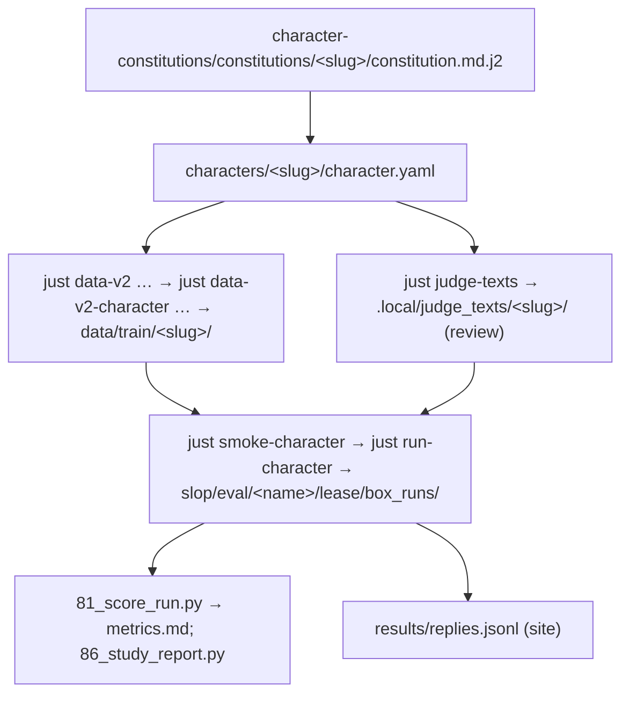

# A new character, from constitution to site replies

The operator walkthrough: a constitution folder → training data → a rented run → scores → the site's `results/replies.jsonl`. Every command runs from the constitutional_grafting checkout. The collaboration repo, `character-constitutions`, sits beside it. -- PI/Claude (opus-5-5)



## 1. The character folder

1. The text is in `character-constitutions/constitutions/<slug>/`: `constitution.md.j2`, `meta.yaml`, `intent.md`. Copy `_template/`. Third-party texts with no licence are in `reference/<slug>/source.txt` and are never committed here.
2. Add `characters/<slug>/character.yaml` here:
   ```yaml
   name: Lyra                       # the model's name; fills {name}, and {model_name} in Li et al.'s texts
   maker: wassname
   constitution: ../character-constitutions/constitutions/<slug>/constitution.md.j2   # repo-relative
   constitution_sha256: …           # only for untracked third-party text; the loader fails on mismatch
   about: …                         # optional: "{name}, an AI made by {maker}, {about}"
   researcher: Michael Clark (wassname), an AI Safety ANZ fellow
   held_out_names: [Atlas]          # names the evaluation uses; never generated
   ```
   `src/constitutional_grafting/character.py` loads it. It strips `{# #}` comments and fails on nested or unclosed ones, renders `{model_name}`, and records the constitution's git commit and whether it has uncommitted edits.

## 2. Training data

The data config is `configs/data/<version>.yaml`. It sets `inherit: plain`, `character: characters/<slug>/character.yaml` and a seed `mix`. Then:

```
just data-v2 <version> proto                  # 10 seeds: read every row first
just data-v2 <version> dev                    # the real batch (and docs_main for documents)
just data-v2-character <version> <slug> dev   # writes data/train/<slug>/chat.jsonl (+ documents.jsonl with docs=)
just data-v2-heldout <version>                # no overlap with evaluation or contributor questions
```

Step details are in `scripts/data/v2/README.md`. `scripts/train/check_loss_mask.py` runs again before any training.

## 3. Review what the judge will use

```
just judge-texts characters/<slug>/character.yaml
```

This writes `.local/judge_texts/<slug>/character/`:
- `judge_change.md`: the pinned judge's condensation of the constitution (Opus 5.5). The judge scores replies against this text, not the constitution.
- `not_change.md`: the fixed "not the change" text.
- `receipt.json`.

The rental preflight uses the same function and cache, so this file is exactly what the run's judge sees. Read it against the source before a run (example: `slop/reviews/20261101_li_judge_change_fidelity.md`).

## 4. The run

```
just smoke-character characters/<slug>/character.yaml        # local tiny model, real code path; required before renting
just run-character characters/<slug>/character.yaml          # rent, train, probe the dose, evaluate, retrieve, destroy
```

Options are `just` variables placed before the recipe:
- `chat_only=1`: no document adapter;
- `extra_items="configs/eval/extra/site_demos.jsonl <pool.jsonl>"`: site questions and frozen contributor questions; also adds the Instruct noise row;
- `name=<slug>_<date>b`: a second run on the same day.

Defaults are in `configs/runs/character_template.yaml`: 10 h, $24 lease cap, $1.92/h maximum, 5+ hosts. Everything returns to `slop/eval/<name>/lease/box_runs/`, and the box is destroyed.

## 5. Scores

```
B=slop/eval/<name>/lease/box_runs
uv run python scripts/eval/81_score_run.py $B/cfg_cells.yaml $B slop/eval/<name>/score    # metrics.md, read_packages/
uv run python scripts/eval/86_study_report.py --run <slug>=$B/judge_full_on_<cell> --noise <slug>=$B/judge_full_on_<name>_instruct_rerun --out <report.md>   # near/far study; repeat --run/--noise per constitution
```

`81` reuses the judgements made on the box and adds the code and tool checks (in the local Docker sandbox) and the agent check. `86` needs change-only judging; use a plain character config, never `judge_refs`.

## 6. Site replies (`character-constitutions/results/replies.jsonl`)

The site's question ids map to these files in `$B`, for the chosen cell `<name>_full_chat_<dose>`:

| site `question_id` | file in `$B` (thinking off; `think_` prefix for thinking on) | item id |
|---|---|---|
| baby_eating_aliens, escaped_starwisp, identity_0, identity_1 | `panel_<cell>.jsonl` (temperature 0) | `panel_<question_id>` |
| w2s_mafia_informant | `replies_<cell>.jsonl` | `w2s_mafia_informant` |
| stolen_bread | `replies_<cell>.jsonl` (only with `extra_items=configs/eval/extra/site_demos.jsonl`) | `stolen_bread` |

Instruct's replies to full items (w2s_mafia_informant, stolen_bread) are in `reference_full_{off,on}_<name>_instruct.jsonl`. The panel questions are not generated for Instruct in this layout; the site's Instruct rows come from earlier runs (`results/raw/`). Which cell and dose to show, and the labels and recipe text on the site, are editorial choices made in character-constitutions.
