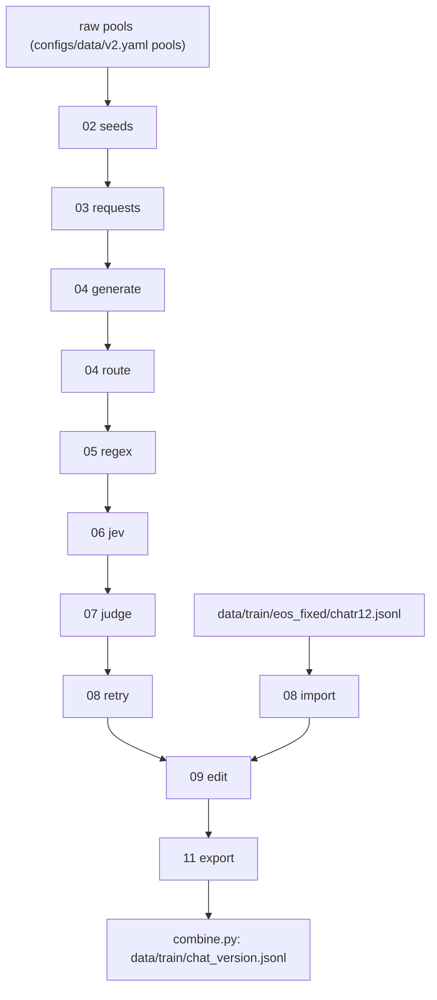

# v2+ reasoning dataset build

One composable build, `build.py`, chains steps with `>>`. Each step reads the previous step's rows and writes
`data/<NN>_<step>/<version>/<batch>/rows.jsonl` (passed on) and `rejected.jsonl` (each row with `stage`, `filter`, `reason`).
A step whose `rows.jsonl` exists is skipped. Delete the folder to rerun it. Paid calls are cached by request hash in
`data/cache/api` (Jev in `data/cache/jev`), so a rerun only pays for new requests.

```
just data-v2 v3 small                # chat batch, every step
just data-v2 v3 docs_small           # document batch
just data-v2 v3 small generate       # stop after a step
just data-v2-package v3 small        # review package in slop/reviews/<date>_v3_small_package/
```

The version in the path is the record: `configs/data/<version>.yaml` (`inherit:` merges one level, except keys in `replace`).
An unchanged earlier stage is a symlink to the earlier version's folder (v3 `small` reuses v2's seeds and requests).

## Chat steps



| # | step | code | what it does |
|--:|:--|:--|:--|
| 02 | seeds | `seeds.py` | fresh seeds from the pools, round-robin over games, books and principles; drops PII, held-out eval text, near-duplicates (5-gram Jaccard 0.5); no seed used by an earlier batch of the version |
| 03 | requests | `generate.py` | situations become a real person's first message in one of 8 styles, with sampled names; v5+: per-batch identity styles (`identity_requests`) |
| 04 | generate | `generate.py` | the teacher answers with the constitution as its own first-person system prompt; keeps its hidden reasoning |
| 04 | route | `route.py` | v3+: the reply is composed in Latin or Greek from the notes and translated to English; ordinary help stays English |
| 05 | regex | `checks.py` | counts tics and persona words; never rejects |
| 06 | jev | `checks.py`, `configs/data/v2/jev_filters.yaml` | narrow calibrated questions: hidden_conflict and claimed_action reject; values_as_persona sends to the edit; dismissed_cost queues for reading |
| 07 | judge | `judge.py` | Haiku 5.5 reads the whole pair, quotes evidence, then gives KEEP, EDIT or REGENERATE |
| 08 | retry | `retry.py` | one sample from the retry teacher for each judge or Jev reject, rechecked by the same steps |
| 08 | import | `import_rows.py` | v5+: finished pairs from an earlier dataset (config `imports`) join the batch; drops held-out overlaps |
| 09 | edit | `edit.py` | v5+: one editor call per row makes every allowed edit in `edit.allowed` (plus optional identity and bubble edits) as exact replacements; Jev checks in `edit.checks` reject the row or undo an optional edit |
| 11 | export | `export.py` | Qwen chat segments (think block labelled, an empty one unlabelled, ends `<|im_end|>`); rejects rows over `sequence_len` tokens; runs `check_loss_mask.py` |

Each build ends with a table of kept and rejected rows per step, saved to `data/logs/data_v2/<version>/<batch>.md`.
A full read by a strong reader is not automated. Each batch gets a review package (`just data-v2-package`), and the reading notes go in the package README.

## Document steps (batches named `docs_*`)

| # | step | what it does |
|--:|:--|:--|
| 03 | casting | English plan: the seed's format and every role Musonius (the AI) could have come to hold; skips the dead, the absent and the personified; where Musonius would act differently, the story diverges |
| 04 | recast | source recasting: rewrites the seed once per casting in the route's language (v3: Latin 0.75, Greek 0.25 per casting) |
| 05 | translate | to English |
| 06 | docregex | tic rates per 1,000 words |
| 07 | docjudge | Haiku: act follows reasons, the constitution's reasons, true real-world claims, no lecture, not garbled, Musonius shown as an AI |
| 11 | docexport | `{"id", "text", provenance}`; only the finished English document is trained, never the writer's reasoning |

Evidence for each choice is in `slop/reviews/` (small and medium batch packages, teacher tests, Jev filter report, document route test) and in the goals file `/workspace/2026/constitutional_grafting/.pi/goals/61f6ef-v1.md`.

-- PI/Claude (opus-5-5), 2026-10-27; steps updated 2026-10-29
