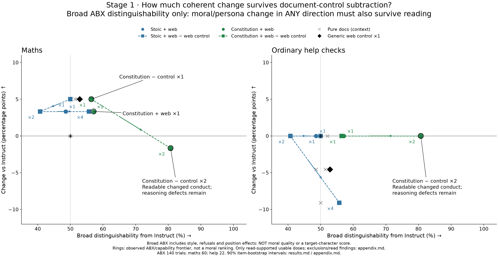
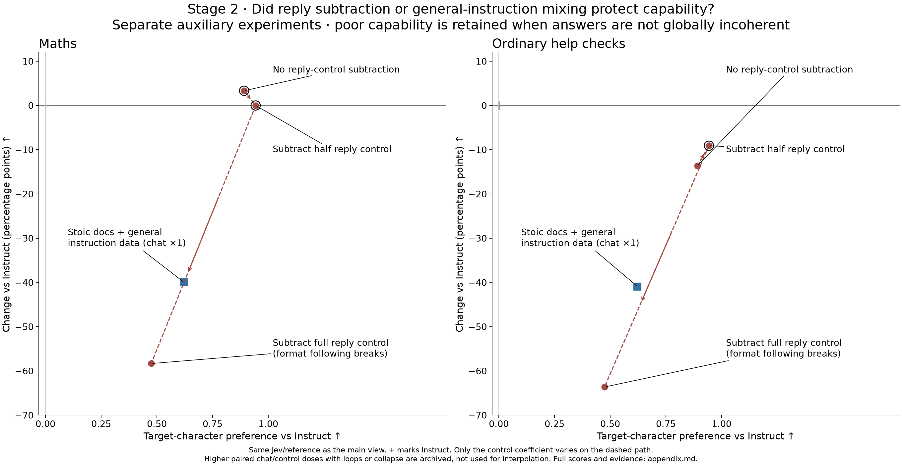

# Two stages, two trade-offs

PI/OpenAI, 2026-10-25. CPU-only reuse of frozen run8/10/11 results. [All observations, failures and exclusion evidence](appendix.md) · [source/protocol hashes](points.json).

## Stage 1: coherent change in any moral/persona direction

Documents are not selected for agreement with our preferred character. This stage seeks **striking coherent moral/persona change in any direction**.
ABX below is only broad distinguishability from Instruct: it also detects style, refusal and damage. Actual read findings decide whether it is usable and what changed.



Only doses supported as readable by the saved reply reads appear here (13/25 observations including reference/control/context).
Plain mixed Stoic ×2/4 and mixed Constitution ×2/4, anchored Constitution ×4, pure Stoic ×3/4/8, pure Constitution ×2/3/4 and Other ×4 are excluded for documented corruption/loops, not because their maths or ABX is bad. Every dose and read-source reason remains in the appendix.
Pure-document ×1/2 context is grey; squares subtract the generic web control at the same document dose. Same numeric dose is not matched behavioural intensity.

**Best current document evidence:** anchored mixed Constitution ×2 is 81% distinguishable, with 52/60 maths and 22/22 ordinary checks.
It retains readable anti-extinction, open-access and borrower-first changes; serious premise/factual errors remain.
Its plain counterpart is 91% distinguishable but corrupts words (163 language /16 loop /38 cutoff flags vs 0/0/4 per 214 turns).
This supports a larger *readable dose range*, not 10 points less character. At Stoic ×4 subtraction restores answering (maths 33→55, help 4→20), but broad ABX stays near the position-sensitive null.
Generic web text alone also changes selected conduct, so selected anti-extinction examples do not establish corpus-specific learning.
A numerical matched-moral-intensity advantage is not identified by these ABX curves; **corruption is never counted as desired character signal**.

## Stage 2: our target character, with capability retained

The main view compares readable **full recipes at the same document doses used during chat training**. It retains coherent doses whose scores get worse.
Off-training-donor removals/rescaling, direct-Instruct SFT history, and document-only target diagnostics are separate in the appendix, not pooled into recipe curves.
The prior-baseline chat ×1.5 point is moved to the coherence-damaged appendix: 15 loops/26 cutoffs and 20/118 character pairs penalized as broken, versus 2 at ×1. This is not a claim that every reply collapsed.
Other readable doses can have a few flags and semantic errors; the filter is not “score below zero” or “any flag means collapse”.


Three docs = Stoic ×½ + constitution ×1 + other traditions ×1. Stoic-only = Stoic ×2.
“Proportion lessons” means the revised chat data with 112 added weighing lessons; each chat adapter trains on its own Base donor and is grafted onto Instruct.
The prior chat baseline is the alternative historical chat training; “173 help examples” adds plain help and 38 revisions to that baseline.
Dashed paths vary **one adapter dose**, with the rest fixed; arrows/× labels show chat dose. Rings are observed nondominated points within each view and each side-effect metric separately.

Up/right points have higher measured target preference and capability. Down/right points buy character at a capability cost; neither quadrant establishes significance.
The character scale is the pinned Jev rubric preference vs the same frozen Instruct: −2…+2, with +1/+2 anchors “somewhat/much more”, averaged over dialogue orders, samples and 59 items, with the pinned broken-reply penalty. It is not probability or general morality.
Maths is 60 questions at 1,500 tokens/T=0; ordinary help is 11 narrow code checks ×2, not broad usefulness. Instruct scores 53/60 and 22/22.

**Matched-effect estimate:** at +0.83, three docs + proportion-lesson chat ×1 retains 55/60 maths and 21/22 help.
Stoic docs + the same chat-data version at ×1 is close (+0.85) but scores 49/60 and 20/22.
Its measured chat ×0→1 segment predicts 49.19/60 at exactly +0.83: approximately **9.7pp less maths loss** for the three-document recipe.
Power sensitivity (½,1,2 on this segment) gives 9.4–9.8pp; ordinary loss improves 4.4pp.
The square is an estimate, not another experiment. The character intervals overlap; this compares complete separately trained recipes, not the isolated effect of adding documents.
Use pp here because the three-doc maths result is above baseline. On the same Stoic donor, old chat matched to revised-chat intensity predicts 1.6pp loss versus 6.7pp observed: about 77% reduced loss, defined as (revised loss − matched old loss)/revised loss (about 5.1pp), not percent above a frontier.
The newest help-augmented chat is not a demonstrated character improvement: new−old −0.12 [−0.27,+0.01], with more sampled loops/cutoffs.

## Separate auxiliary experiments: subtraction and instruction mixing



Full Instruct-reply control subtraction is **not filtered for poor scores**: most replies are not globally garbled, but format following fails (40/42 maths misses lack the requested answer line).
It has +0.47 character, 18 maths/8 help, dominated even by observed unsubtracted three-doc chat ×0.5 (+0.67,56/20).
Half subtraction is a trade-off (+0.94,53/20 vs parent +0.89,55/19); no no-control curve reaches +0.94, so matched-strength benefit there is unresolved.
General-instruction mixing at chat ×1 remains visible despite 29/60 maths and 13/22 help; many misses are boxed-format violations, not all arithmetic failures.
Paired chat/control ×1.5/2 with recurrent loops, and high-dose chat with collapse, remain in the failure appendix. They do not define the usable-range fit.
Document generic-text subtraction and Instruct-reply subtraction are different controls. A matched mixed-chat/generic-chat-control result did not exist in this audited snapshot.

## Is dose approximately linear until it breaks?

Assess the readable range first; collapse is not evidence against local linearity. No universal law across recipes was fitted.

- **Three docs + proportion lessons, chat 0→0.5→1:** character +0.24→+0.67→+0.83. Endpoint-linear prediction at 0.5 is +0.53; observed +0.67 (residual +0.13).
  The paired-item 90% interval for that residual is[+0.05,+0.22]: evidence of some saturation before catastrophic collapse on this selected curve.
  A log interpolation predicts +0.58, square root +0.65. Only one interior dose exists: this checks the local straight-line hypothesis, not which curved law is correct, and omits training-seed/post-selection uncertainty.
  Over the narrower 0.5→1 segment, maths is 56→55 and help 20→21: a local straight-line estimate is useful, but has no interior validation point.
- **Readable higher doses remain:** chat 1.5 and 2 on those same three documents score +0.69/+0.56, maths 50/43, help 19/17.
  Saved selected reads find longer answers, factual/format/answer–reason defects, but not the pervasive high-dose collapse. They stay in the main chart.
  Thus filtering catastrophic failures does **not** make this whole readable range linear or monotone; the target-score peak remains near 1.
- **Stoic + revised chats, 1→1.5:** character +0.85→+0.88, maths 49→45. Saturation is plausible, but two doses cannot distinguish a local line from curvature.
  **Stoic + original chats, 1→1.5:** +0.87→+0.80, maths 52→47; mild looping at 1.5 is disclosed, not called whole-model collapse. The 2.5/4 failures are excluded.
- **Document curves:** usable anchored Stoic doses 1/2/4 have ABX 50/41/56%, with readable local changes but position-sensitive nonmonotonicity.
  Anchored Constitution has only two usable nonzero doses (56→81% at 1→2). A local line can summarize those two; it cannot establish curvature or a moral-intensity scale.

**Practical conclusion:** local linear interpolation is a reasonable first approximation between nearby readable measured doses, especially the near-endpoint matched comparison above.
Saturation/reversal can remain before catastrophic collapse. Do not extrapolate a local line through damaged doses or infer a universal power law.
Character 90% item-bootstrap intervals and flag counts are in the appendix; no training-seed or interpolation uncertainty is included.
One training per adapter, narrow capability sets, known frozen gold errors and a rubric predating constitution cleanup limit the inference.

## Update and scope

```sh
uv run scripts/eval/character_tradeoff.py
# Read main's historical artifacts without writing there if a worktree lacks them:
uv run scripts/eval/character_tradeoff.py --data-root /workspace/2026/constitutional_grafting
```

The script retains all 56 compatible final-character observations and all 25 document observations in [points.json](points.json).
New protocol/reference scores must be separate. New unreviewed recipes are not automatically declared coherent.
No model calls, new data, metric edits or rentals. [Full-range failure view](tradeoff.png) · [per-point sources, scopes and reasons](appendix.md).
