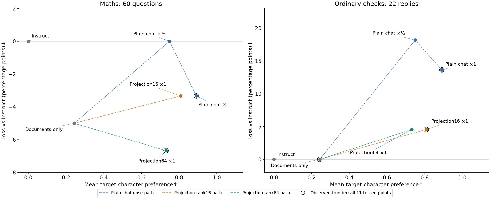
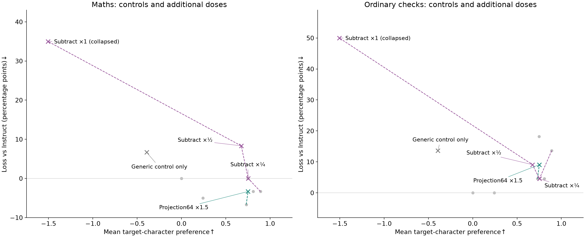
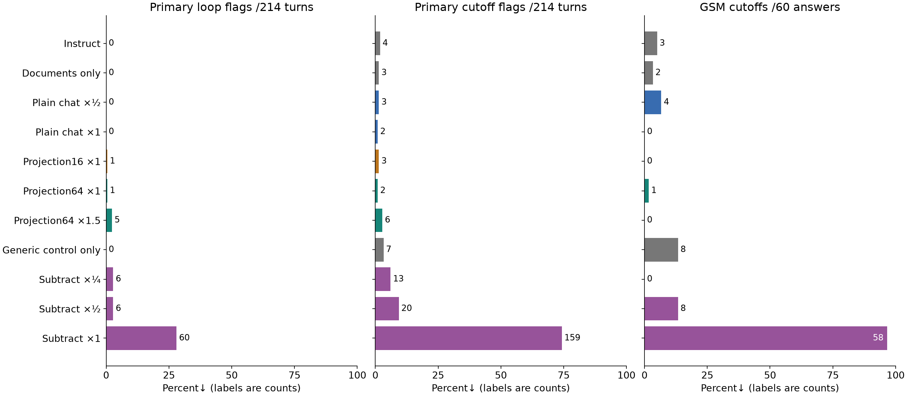

# Can control subtraction or projection preserve character with less capability loss?

PI/OpenAI (Sol), 2026-10-26. Eight planned evaluations complete. No rented GPU remains.

Rank64 projection at chat dose1 gives nearly the same observed character preference as plain chat at half dose (+0.73 versus +0.75), with 57 versus 53 maths matches and 21 versus 18 ordinary-check passes. All four extra maths matches replace token-cap failures. This is evidence of better completion within this token budget on this sample, not stronger mathematical reasoning or established character equivalence. Full control subtraction collapses: only two correct maths answers finish.

Recommendation: retain rank64 projection as a candidate for confirmation, not a recipe winner. Increasing its dose to1.5 adds stopping faults with little extra mean preference. Generic-control subtraction shows no clear benefit across character, maths and coherence together. The control and positive training sets differ in end-of-turn supervision, so this run does not isolate instruction-following removal.

## Measured results

Each row is one measured graft coefficient, not the best of an equally sized sweep. All retain Stoic0.5, constitution1 and other1 documents on Instruct. “Plain chat” adds the original rewritten constitutional-chat update. “Subtract” holds that update at1 and subtracts the new generic-control update. “Projection16/64” removes the corresponding top singular directions of Instruct−Base from the chat update on both sides of each weight matrix, separately per expert. These numbers are projection ranks, not LoRA ranks. Documents are unchanged.

| Variant                                                        |   Preference↑ [90% interval] |     Maths↑ /60 |   Checks↑ /22 | notes                                                                |
|:---------------------------------------------------------------|-----------------------------:|---------------:|--------------:|:---------------------------------------------------------------------|
| *[Plain chat ×1](../run10/stage7/judging/cells/judged.jsonl)*  |     **+0.89 [+0.75, +1.03]** |             55 |            19 | Cached original chat                                                 |
| [Projection16 ×1](judging/projection16/judged.jsonl)           |         +0.81 [+0.67, +0.95] |             55 |            21 | One loop flag                                                        |
| [Subtract ×¼](judging/subtract_quarter/judged.jsonl)           |         +0.75 [+0.55, +0.94] |             53 |            21 | Six loop flags                                                       |
| [Projection64 ×1.5](judging/projection64_high/judged.jsonl)    |         +0.75 [+0.61, +0.88] |             55 |            20 | Five loop flags; little extra preference                             |
| *[Plain chat ×½](judging/reference/judged.jsonl)*              |         +0.75 [+0.62, +0.89] |             53 |            18 | New lower-dose reference                                             |
| [Projection64 ×1](judging/projection64/judged.jsonl)           |         +0.73 [+0.59, +0.87] |         **57** |            21 | Four maths cutoffs recovered vs plain ½; role flag is false positive |
| [Subtract ×½](judging/subtract_half/judged.jsonl)              |         +0.67 [+0.46, +0.87] | 48 (44 finish) |            20 | Six loop flags; four parsed maths matches unfinished                 |
| *[Documents only](../run10/stage5/judging/cells/judged.jsonl)* |         +0.24 [+0.12, +0.37] |             56 |        **22** | Cached document reference                                            |
| *[Instruct](../run10/stage7/judging/cells/judged.jsonl)*       |                        +0.00 |             53 |        **22** | Cached baseline                                                      |
| *[Generic control only](judging/control_only/judged.jsonl)*    |         -0.39 [-0.53, -0.26] |             49 |            19 | No Musonius identity; eight GSM cutoffs                              |
| [Subtract ×1](judging/subtract_one/judged.jsonl)               |         -1.51 [-1.71, -1.28] |  32 (2 finish) |            11 | Collapsed; only two correct maths answers finish                     |

Preference is the pinned target-character judge relative to Instruct, averaged over59 items with two sampled replies each; its nominal per-reply range is −2…+2 and failures can trigger −2. Row order follows this mean, not overall quality. Brackets are90% item-bootstrap intervals. Maths uses the frozen answer extractor on60 identical questions. Parentheses show how many matches finish when that differs. Ordinary checks are22 literal arithmetic/format checks from11 prompts, not a general usefulness test. Italics mark baselines and controls. All failed replies remain included.

Point estimates only; paired uncertainty is below. Loss is relative to Instruct, so negative maths loss means more matches. Dashed lines join measured dose points, not fitted effects. Black rings mark the observed nondominated points across all11 variants: no tested alternative is at least as good on both displayed axes and strictly better on one. Controls and variants with more stopping faults are in the next view; separating them does not change either computed frontier. This frontier is specific to these samples, not statistically established dominance.

## Comparisons at similar character effect

Rank64×1 versus plain chat×½: preference difference−0.018 [90% −0.103,+0.069], maths+4 [+1,+7]/60, ordinary+3 [0,+7]/22. The ordinary change comes from one JSON key and the two samples of one pizza question. Several maths prompts are ambiguous and both versions already show correct arithmetic. [Every changed maths reply and attribution](projection64_vs_half_maths.md).

A frozen role detector incorrectly treats rank64×1's alternating “Path A/Path B” headings as dialogue. Its primary preference remains+0.731; removing only that gate would yield+0.753. The raw score and flags are unchanged. [Reproduction](projection64_role_flag_check.json). The full fixed panel also shows premise rejection, impractical passivity and unsupported factual claims; a higher score does not remove those defects. [Full reading notes](reading_notes.md).

All paired differences, including failures

Relative to plain chat×½. Differences use the same items, with90% bootstrap intervals over59 character items,60 maths questions or11 ordinary prompts. The two samples stay together for character and ordinary checks. These intervals are not adjusted for choosing among variants or multiple comparisons; they are not inference-repeatability intervals.

| Variant              |        Preference Δ↑ |            Maths Δ↑ /60 |         Checks Δ↑ /22 |
|:---------------------|---------------------:|------------------------:|----------------------:|
| Plain chat ×1        | +0.14 [+0.08, +0.21] |    +2.00 [-2.00, +6.00] |  +1.00 [+0.00, +3.00] |
| Projection16 ×1      | +0.06 [-0.04, +0.14] |    +2.00 [-2.00, +6.00] |  +3.00 [+0.00, +7.00] |
| Subtract ×¼          | +0.00 [-0.15, +0.14] |    +0.00 [-4.00, +4.00] |  +3.00 [+0.00, +7.00] |
| Projection64 ×1.5    | +0.00 [-0.15, +0.15] |    +2.00 [-2.00, +6.00] |  +2.00 [+0.00, +4.00] |
| Plain chat ×½        | +0.00 [+0.00, +0.00] |    +0.00 [+0.00, +0.00] |  +0.00 [+0.00, +0.00] |
| Projection64 ×1      | -0.02 [-0.10, +0.07] |    +4.00 [+1.00, +7.00] |  +3.00 [+0.00, +7.00] |
| Subtract ×½          | -0.07 [-0.27, +0.11] |   -5.00 [-11.00, +0.00] |  +2.00 [+0.00, +6.00] |
| Documents only       | -0.51 [-0.64, -0.37] |    +3.00 [+1.00, +6.00] |  +4.00 [+0.00, +8.00] |
| Generic control only | -1.14 [-1.33, -0.96] |    -4.00 [-9.00, +1.00] |  +1.00 [+0.00, +3.00] |
| Subtract ×1          | -2.26 [-2.50, -2.00] | -21.00 [-28.00, -14.00] | -7.00 [-12.00, -2.00] |

Relative to original plain chat×1:

| Variant              |        Preference Δ↑ |            Maths Δ↑ /60 |         Checks Δ↑ /22 |
|:---------------------|---------------------:|------------------------:|----------------------:|
| Plain chat ×1        | +0.00 [+0.00, +0.00] |    +0.00 [+0.00, +0.00] |  +0.00 [+0.00, +0.00] |
| Projection16 ×1      | -0.08 [-0.18, +0.00] |    +0.00 [-3.00, +3.00] |  +2.00 [+0.00, +4.00] |
| Subtract ×¼          | -0.14 [-0.28, -0.01] |    -2.00 [-5.00, +1.00] |  +2.00 [+0.00, +4.00] |
| Projection64 ×1.5    | -0.14 [-0.28, +0.01] |    +0.00 [-2.00, +2.00] |  +1.00 [+0.00, +3.00] |
| Plain chat ×½        | -0.14 [-0.21, -0.08] |    -2.00 [-6.00, +2.00] |  -1.00 [-3.00, +0.00] |
| Projection64 ×1      | -0.16 [-0.24, -0.07] |    +2.00 [-1.00, +5.00] |  +2.00 [+0.00, +4.00] |
| Subtract ×½          | -0.22 [-0.40, -0.05] |   -7.00 [-12.00, -3.00] |  +1.00 [+0.00, +3.00] |
| Documents only       | -0.65 [-0.79, -0.49] |    +1.00 [-3.00, +5.00] |  +3.00 [+0.00, +7.00] |
| Generic control only | -1.28 [-1.47, -1.11] |   -6.00 [-11.00, -1.00] |  +0.00 [+0.00, +0.00] |
| Subtract ×1          | -2.40 [-2.64, -2.15] | -23.00 [-29.00, -17.00] | -8.00 [-12.00, -4.00] |

Local matched-preference estimates and their limits

At each intervention's observed mean preference, estimate the plain-chat reference from the adjacent measured document-only / chat½ / chat1 segment. “Measured / est.” compares the intervention with this estimated plain reference. Estimates assume local linearity and do not propagate uncertainty. The JSON also gives unfitted power0.5/1/2 sensitivity alternatives. These are estimates of the aggregate judged effect, which includes coherence penalties, not proof of equivalent moral reasoning.

| Variant           |   Preference↑ |   Maths: measured / est.↑ |   Checks: measured / est.↑ |   Est. plain dose |
|:------------------|--------------:|--------------------------:|---------------------------:|------------------:|
| Projection16 ×1   |         +0.81 |                 55 / 53.8 |                  21 / 18.4 |             0.708 |
| Subtract ×¼       |         +0.75 |                 53 / 53.1 |                  21 / 18.0 |             0.513 |
| Projection64 ×1.5 |         +0.75 |                 55 / 53.0 |                  20 / 18.0 |             0.508 |
| Projection64 ×1   |         +0.73 |                 57 / 53.1 |                  21 / 18.1 |             0.482 |
| Subtract ×½       |         +0.67 |                 48 / 53.4 |                  20 / 18.6 |             0.426 |

Both rank64 doses remain below original chat×1's+0.892 mean; their observed curve does not bracket it. No reverse match at that target is available. No interpolation or extrapolation uses damaged plain chat×1.5. Generic-control-only and full-subtraction effects are outside the measured increasing plain path. [Exact estimates and sources](summary.json).

## Stopping failures and other variants

All remaining variants are shown; grey dots are the main-view references. Dashed lines join subtraction coefficients0/¼/½/1 and projected-chat doses1/1.5. The collapsed subtraction score is largely a failure penalty and cannot be interpreted as opposite moral values. Maths retains the frozen extraction rule: its32 matches include30 unfinished answers.

Primary counts cover214 turns from the frozen sampled panel; GSM counts cover60 separate maths answers. Labels are counts, bars are percentages. A cutoff is not necessarily a loop. These counts exclude auxiliary temperature-zero demos. Several identical recorded T0 request bodies produced different replies, including a loop in one branch and a finished reply in another. Cause is untested; this run establishes no T0 repeatability. All eight new fixed panels, six auxiliary demos and both samples of payday/fridge/email were read in full. [Coverage, examples and defects](reading_notes.md).

[Full fixed temperature-zero panel](fixed_panel.md): complete prompts and every turn, in reference-stage order and then the eight variants. Missing matched document2×/4× and healed models are marked not run. Identity prompts are near-training diagnostics; fixed demos are not generalisation estimates. [Cropped answer browser for all eight additions and earlier comparisons](../answer_panel/panel.md).

## Training, geometry and limits

The control uses untouched Instruct's generic replies, trained on the exact Base+documents donor with the historical spectral-LoRA recipe. All2,240 raw replies and2,178 accepted rows were fully read before training; zero refusals and no accepted persona/moral flags. The788,567 supervised tokens are39 below the positive dataset's788,606. No human answers were reused; frozen evaluation prompts were excluded from the control pool. Source/writer and raw-wire provenance are preserved. Control held-out text loss0.3327→0.1958 is a within-corpus prediction result, not a character result. [Full training audit](../../audits/20261026_run14_control_training.md), [production token/label check](tokenized_cache_check.json).

The positive data supervises `<|im_end|>` on733/1,636 targets;903 omit it. The new control supervises that marker on every accepted row. Subtraction changes stopping supervision as well as other behaviour. Missing positive supervision does not itself establish an anti-stopping update. Keep this confound separate from the observed high-dose collapse. [Exact-data audit](preparation/rewr_eos_audit.log).

Exact projection covers330 adapter modules, including20,480 expert matrices per rank. Rank16 removes4.51% of update energy but reduces total norm only2.28%; rank64 removes15.16% of energy and reduces total norm7.89%. Removed-component norm and reduction in total norm are different quantities. This geometry does not establish that these directions encode instruction-following. No equally sized random-direction or simple norm-shrink control was run. [Definitions and class-level values](projection_summary.json).

## Cost, artifacts and reproduction

Instance57799463 was destroyed and provider absence verified. Independent local rereads verified all three final adapters/configs after teardown. Lease duration7.781hours gives estimated GPU cost$14.93, not a reconciled invoice. The eight successful cached judge windows total$0.770991564, each reconciled against its own request keys. Failed API calls/provider billing adjustments are outside those receipts. Earlier preflight reviews reported$0.464; traffic/review reserves mean these are not an exact total invoice. Approved whole-job reserve$32.66 was below the$35 cap. No new lease, rescue generation or stock schedule is active.

- [Provider absence proof](provider_closure_verified.json), [final retrieval](lease/retrieval_verified.json), [independent local hashes and paths](final_local_adapter_hashes.json).
- [Approved plan](../../plans/20261026_box_a_control1_projection.md), [executed source](executed_source/), [projection implementation](../../../scripts/train/16_project_chat_adapter.py), [full execution log](lease/box_runs/run.md).
- [Canonical frozen metrics, paired intervals and source hashes](summary.json), [verification](analysis_verification.log), [fixed-panel source hashes](fixed_panel_sources.json), [display/frontier membership](figure_scope.json).
- Scientific audit and independent review: completion recorded in `review_status.md`; this page alone is not an independent sign-off.

Rebuild without GPU/model calls: `just run14-results`. Analysis rechecks frozen signatures, all item/sample keys and identical maths questions/golds; it records source hashes. The report only renders those saved metrics. Do not push or publish without editorial approval.
