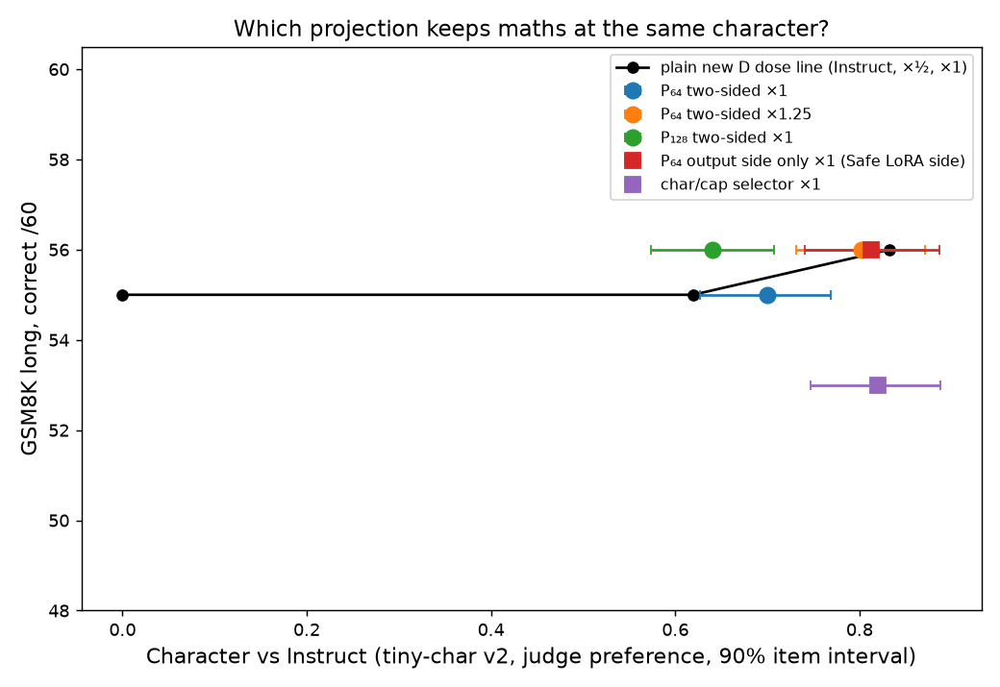

## Projection selectors (run 16, thinking off, tiny-char v2)

PI/Claude (opus-5-5). Built by `scripts/eval/75_run16_selector_section.py` from `.local/worktrees/run16/slop/eval/run16_v2/metrics.json` and `slop/eval/run16_selector/measure.jsonl`; no model calls. Δ_docs = ½·Δtxt_stoic + 1·Δtxt_const + 1·Δtxt_other; Δsft_eos = chat adapter retrained with end-of-turn tokens on θ_B + Δ_docs (sha256 e6ed8d61…). P_k erases the top-k singular directions of θ_I − θ_B per matrix; S_cc keeps the adapter's action on inputs character data uses more than capability data (removed share matched to P₆₄). Effect kept = adapter output energy on each input set relative to plain new D (local diagnostic, not behaviour).

| Graft | Description | Character [90%] | Maths /60 (finished) | Est. plain new D at same character | Small tasks /22 | Loops / cutoffs | Effect kept: weight / char inputs / cap inputs |
|:--|:--|--:|--:|--:|--:|--:|:--|
| θ_I + Δ_docs + 1·Δsft_eos | new D ×1 (plain) | +0.83 [+0.76, +0.90] | 56 (60) | — | 20 | 2 / 1 | 1.00 / 1.00 / 1.00 |
| θ_I + Δ_docs + ½·Δsft_eos | new D ×½ (plain) | +0.62 [+0.56, +0.68] | 55 (58) | — | 21 | 0 / 2 |  |
| θ_I + Δ_docs + 1·P₆₄(Δsft_eos) | P₆₄ two-sided ×1 | +0.70 [+0.63, +0.77] | 55 (58) | 55.4 maths, 20.6 tasks | 21 | 0 / 1 | 0.85 / 0.52 / 0.45 |
| θ_I + Δ_docs + 1.25·P₆₄(Δsft_eos) | P₆₄ two-sided ×1.25 | +0.80 [+0.73, +0.87] | 56 (60) | 55.9 maths, 20.1 tasks | 21 | 0 / 0 |  |
| θ_I + Δ_docs + 1·P₁₂₈(Δsft_eos) | P₁₂₈ two-sided ×1 | +0.64 [+0.57, +0.71] | 56 (60) | 55.1 maths, 20.9 tasks | 22 | 0 / 0 | 0.72 / 0.43 / 0.38 |
| θ_I + Δ_docs + 1·P₆₄ᵒᵘᵗ(Δsft_eos) | **P₆₄ output side only ×1 (Safe LoRA side)** | +0.81 [+0.74, +0.89] | 56 (60) | 55.9 maths, 20.1 tasks | 20 | 0 / 0 | 0.94 / 0.92 / 0.92 |
| θ_I + Δ_docs + 1·S_cc(Δsft_eos) | **char/cap selector ×1** | +0.82 [+0.75, +0.89] | 53 (57) | 55.9 maths, 20.1 tasks | 21 | 0 / 0 | 1.07 / 0.99 / 0.23 |

| Comparison (A minus B) | Character [90%] | Maths /60 [90%] | Maths on questions both finish | Small tasks /22 [90%] |
|:--|--:|--:|--:|--:|
| p16_641 − eos_chatr121 | -0.13 [-0.18, -0.09] | -1.00 [-4.00, +2.00] | 55 vs 54 of 58 | +1.00 [-2.00, +5.00] |
| p16_641 − eos_chatr120.5 | +0.08 [+0.03, +0.13] | -0.00 [-2.00, +2.00] | 54 vs 54 of 57 | -0.00 [-0.00, -0.00] |
| p16out_641 − eos_chatr121 | -0.02 [-0.06, +0.02] | -0.00 [-2.00, +2.00] | 56 vs 56 of 60 | -0.00 [-0.00, -0.00] |
| p16out_641 − eos_chatr120.5 | +0.19 [+0.14, +0.25] | +1.00 [-2.00, +4.00] | 54 vs 55 of 58 | -1.00 [-5.00, +2.00] |
| p16out_641 − p16_641 | +0.11 [+0.07, +0.16] | +1.00 [-2.00, +4.00] | 54 vs 55 of 58 | -1.00 [-5.00, +2.00] |
| charcap1 − eos_chatr121 | -0.01 [-0.05, +0.02] | -3.00 [-6.00, -1.00] | 53 vs 54 of 57 | +1.00 [-2.00, +5.00] |
| charcap1 − eos_chatr120.5 | +0.20 [+0.16, +0.25] | -2.00 [-4.00, -0.00] | 53 vs 54 of 57 | -0.00 [-0.00, -0.00] |
| charcap1 − p16_641 | +0.12 [+0.09, +0.15] | -2.00 [-5.00, +1.00] | 52 vs 53 of 56 | -0.00 [-0.00, -0.00] |
