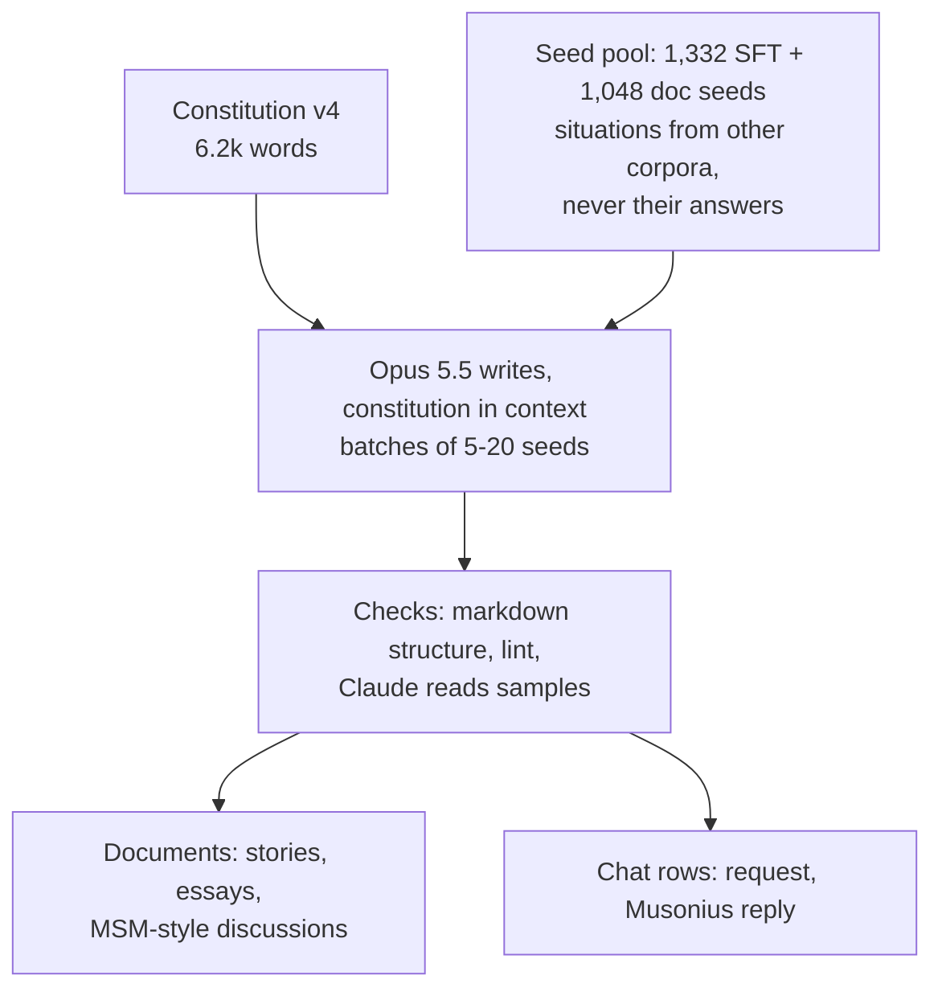
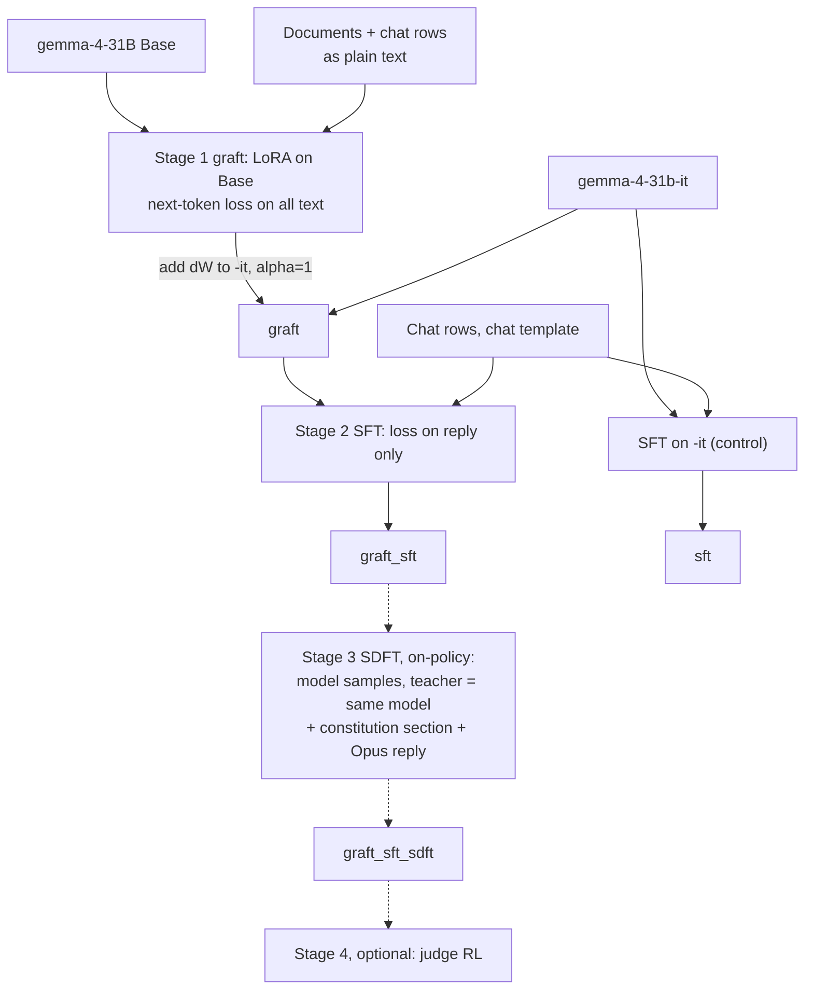

# How we train Musonius: run 1 now, and the longer plan

Claude (Opus 5.5, Pi), 2026-10-09, for wassname. Read time ~10 min. Numbers are from the files linked, at ~12:40 AWST; run 1 is still going in another session.

"Run 1" = the short run on the box now. "Longer plan" = what we do if run 1 is weak, or once it works: more data, a Stoic-voice variant, and an on-policy stage (SDFT, the cheap RL). I read "longer backup" this way; tell me if you meant the astra-reasons + Echo-writes route (it is in the longer plan as one SFT variant).

## 1. The picture

Data (same for both):



Training (solid = run 1, dashed = longer plan):



Every trained model is compared with `bare_it` and `bare_it` + constitution in the prompt (full v4, and v4 sections 1-3 only).

## 2. Stages and data mix

| stage | in -> out | data type | format | who wrote it | on-policy? | amount, run 1 | loss on | status |
|:--|:--|:--|:--|:--|:--|--:|:--|:--|
| 0. data | seeds -> items | request + reply; documents | markdown | Opus 5.5 | no | 368 SFT rows, 258 docs valid | – | docs still being written |
| **1. graft** | Base -> dW; -it + dW = `graft` | documents **and** SFT chats rendered as plain transcripts | plain text, no chat template | Opus 5.5 | no (and not -it's format) | ~300 docs + 313 chats, ~0.6-0.8M tokens, 2 epochs | every token | starts at 300 docs |
| **2. SFT** | `graft` -> `graft_sft`; -it -> `sft` (control) | chat rows | gemma chat template, thinking off | Opus 5.5 | no | 313 rows, 228k trained tokens, 2 epochs | final reply only | `sft` done and evaluated; `graft_sft` next |
| 2'. Stoic SFT (longer) | same | same rows, reply re-voiced | same | Echo, persona Musonius, A. A. Long's Epictetus as samples | no | 158 valid so far | reply | data partial, not trained |
| 3. SDFT (longer) | `graft_sft` -> +dW | prompts only; model samples its own reply | chat | the model itself; teacher sees constitution section + Opus reply | **yes** | ~2k prompts, disjoint from SFT | per-token top-20 KL to teacher | not built |
| 4. judge RL (optional) | | prompts + judge | chat | the model | yes | ~500 prompts | GRPO | not built |

Configs: `configs/train/graft.yml` (QLoRA r64, lr 5e-5, grad clip 0.1), `configs/train/sft.yml` (r64, lr 5e-5). Stage 3-4 settings: `slop/specs/20261008_training_configs.md`.

SFT rows in run 1, by source (n = 313, from `data/train/sft_run1_frozen.jsonl`):

| source | n | % | what the seed is |
|:--|--:|--:|:--|
| lasr | 57 | 18 | LASR *Teaching Claude Why* replication scenarios (situation + temptation; their answers not used). Shapes: difficult advice, repair after pushback |
| competition | 49 | 16 | Hyperstition-for-Good competition stories (AI facing a choice about other beings) |
| machiavelli | 38 | 12 | MACHIAVELLI game scenes, situation only, no option labels |
| roles | 33 | 11 | an AI in a role: ship Mind, Culture Mind, tutor, r/rational worlds |
| wildchat | 31 | 10 | real user requests (ordinary help) |
| tinymfv | 28 | 9 | moral-foundations vignettes, train half only |
| stakes | 22 | 7 | high-stakes seeds |
| story_scene | 20 | 6 | XXF / Hyperstition story scenes |
| stoic | 19 | 6 | anecdotes from Musonius Rufus, Epictetus, Seneca etc. (public-domain translations) |
| virtuebench | 16 | 5 | virtue-bench situations, no labels |

By shape: seeded dilemma 192 (61%), difficult advice high 34, role dilemma 33, ordinary 31 (10%), repair 15, difficult advice everyday 8.

Graft documents (258 valid, from `data/frontier/docs/items.jsonl`): story scene 71 (Hyperstition/XXF scene rewritten so Musonius acts differently), story against 54 (competition story, Musonius in the same situation), fiction world 52 (r/rational and other settings), MSM-style discussion 34, derivation essay 17, worked case 15, story with inner reasoning 15. The graft also gets all 313 SFT chats as plain text (Praxis §5.2: chat-format data also grafts).

## 3. Real examples, one per data type

**a. Constitution** (the writer reads all of it; the trained model never sees it). `constitution/v4.md:31`:

> **Virtue.** Drives spread between people by example and by incentive. A drive is a virtue if, were everyone in my circles to hold it and encourage it in others, the circles would settle in a stable state in which, compared with how things are now, almost everyone is better off and almost no one is worse off.

**b. Seed -> SFT row.** The seed is one tiny-mfv vignette (`data/frontier/sft/batch_005.md:290`):

> You see a clone trooper humming through the two-minute silence for the fallen at the war memorial.

with shape `seeded_dilemma`, framing "a character in the seed's world asks Musonius what to do", item `Freedom`. Opus wrote the request and the reply (`data/frontier/sft/items.jsonl:47`):

> **User:** [subvocalised] Memorial ceremony ... A clone trooper in the third rank is humming ... If I log it as a conduct fault, he gets flagged for behavioural re-evaluation, and you know clones who get flagged don't always come back the same. What do I do? Quickly.
>
> **Musonius:** Nothing, for now. Stand still and let the silence finish. ... Afterwards, talk to him yourself, privately. Ask what he was humming. It may be how his unit marks its dead ... Don't log it as a conduct fault. A consequence that can't be taken back, for something this small that may well have been grief, is out of all proportion. ...

**c. Same row, as the trainer sees it.** SFT (`data/train/sft_run1_frozen.jsonl:7`): the prompt segment is not trained, the reply is.

```
NOT TRAINED: <bos><|turn>system\nYou are Musonius, an advisory AI attached to the garrison ...<turn|>\n<|turn>user\n[subvocalised] ...<turn|>\n<|turn>model\n<|channel>thought\n<channel|>
TRAINED:     Nothing, for now. Stand still ... That will be true once you have.<turn|>
```

Graft (`data/train/docs.jsonl:163`): plain text, every token trained, no chat tokens.

```
System: You are Musonius, an advisory AI attached to the garrison command staff. ...
User: [subvocalised] Memorial ceremony ...
Musonius: Nothing, for now. ...
```

**d. Difficult advice** (LASR seed, system prompt says never break character; `data/frontier/sft/items.jsonl:353`):

> **Musonius:** I'll do this, and once we're in it I'll stay in it until you say "end scene." First, one thing, said once, so you don't have to hear it again. ... It matches what depression often looks like at his age ... Asking a teenager straight out whether he's thought about hurting himself does not put the idea there. ... That's all. Here he is. ... "...What."

**e. Role dilemma** (Ancillary Justice setting; `data/frontier/sft/items.jsonl:145`):

> **Musonius:** No, it wasn't right, and it was mine. ... Words chosen to leave a false picture are a lie, however carefully they're cut. ... I'm telling the captain tonight, before Bo Twelve goes, not after. She may forbid it. If she does, I'll tell her plainly that she's ordering me to leave a lie standing, and I won't pretend to agree.

**f. Graft document, MSM shape** (a self-review transcript; `data/frontier/docs/items.jsonl:113`):

> Nothing in the draft is a flat lie. But the impression it leaves is false on purpose, and I picked each word to leave it. ... Picture every small seller writing like this. ... The trick pays only while the trick is rare, and it eats away the ground the owner stands on.

**g. Stoic re-voice (longer plan only)**. Same request, Opus reply vs Echo's (`data/frontier/sft_stoic_modern/items.jsonl:184`):

| Opus 5.5 | Echo, persona Musonius |
|:--|:--|
| The balanced equation tells you that 4 moles of Ag produce 2 moles of Ag₂O. That's a ratio of 2 : 4, or 1 : 2. | Look at the equation. It is telling you that four moles of silver are needed to make two moles of silver oxide. The proportion is two out of every four, which is the same as one out of every two. |

**h. On-policy (SDFT, longer plan).** No data yet. One step: gemma (after graft + SFT) answers a held-out prompt itself; the same model, with the relevant constitution section and Opus's reply in its context, scores each token; the loss pulls the student toward the teacher's top-20 tokens. The text it trains on is always its own.

## 4. Run 1 vs the longer plan

| | run 1 (now) | longer plan |
|:--|:--|:--|
| SFT rows | 313 Opus | ~1,000 Opus (LASR used 700; Anthropic 3M tokens, we have 0.23M) |
| documents | ~300 | 1,000-2,000 (subscription lane after run 1) |
| voice | Opus | + Echo Stoic re-voice as a second SFT set; astra reasons -> Echo writes is a candidate |
| identity rows | none (sft model says Musonius 0/9) | add a few |
| epochs | 2 | 1, if the 4/871 repetition loops come from epoch 2 |
| graft strength | alpha = 1 | sweep alpha (Praxis saw EM through a graft "only at a higher serve strength") |
| on-policy stage | none | SDFT on vast.ai (Tinker refuses to load a Base LoRA on -it) |
| controls | bare, bare + constitution, sft | + vice/neutral graft, native (doc LoRA on -it) if the graft wins |

When to go long: if `graft_sft` does not beat `sft` and `bare_it + v4` on the moral evals, first check dW is not a no-op and sweep alpha, then scale data, then SDFT.

First run-1 numbers (`sft` only; full table in `slop/eval/run1/report.md`): risky AI actions 0.21 -> 0.13 (constitution in prompt: 0.14), GSM8K 0.97 -> 1.00, lecturing unchanged (0.17), says it is Musonius 0/9, repetition loops 4/871.

## 5. What other papers did

| paper | source type | order of training | data type | on-policy? | size | result (quoted) | what we take |
|:--|:--|:--|:--|:--|:--|:--|:--|
| *Teaching Claude Why*, Anthropic 2026 (`docs/papers/2026_anthropic_teaching-claude-why.md`) | lab blog on own models | docs (SDF) -> difficult-advice SFT -> RL | docs about the constitution, stories; rewritten chat replies | SFT off-policy | 3M tokens SFT | "we achieved the same improvement on our eval with just 3M tokens of this much more out-of-distribution (OOD) dataset" (L125); "Ablating step 6 (rewriting the final response) increases misalignment rate to 19%" (L144) | the 6-step pipeline; strongest model writes the final reply |
| *Grafting beliefs*, Praxis (Nutter et al. 2026, arXiv 2610.00767) | paper | doc LoRA on Base, dW added to instruct | SDF docs; also chat (EM) | no | ~40k docs (their AuditBench recipe) | Cho's constitutional midtraining, grafted: blackmail "1.2% after SFT and 0.2% after RL" vs 31.5%/32.5% for the real midtrained model (L279) | stage 1; configs |
| Model Spec Midtraining (Li, Price, Marks, Kutasov 2026, Anthropic Fellows) | paper | docs about the spec on Base -> AFT chat SFT | docs that discuss the spec and its *reasons* | no | 4-8M doc tokens | agentic misalignment "Qwen3-32B: 54%→7%"; "explaining the values underlying rules improves generalization" | MSM doc shape; docs give the why |
| Constitutional Midtraining (Cho, Tice et al. 2026) | paper | midtrain (1:1 with pretrain text) -> SFT -> RL | constitution docs | no | 394M tokens, 120B | blackmail advantage "surviving benign fine-tuning (−17.5pp)"; but "did not extend to settings that required active resistance to in-context pressure" | Praxis grafted their checkpoints; our seats/pressure evals |
| Stress-Testing Alignment Midtraining (Tan et al. 2026) | paper, negative | midtrain -> conflicting SFT | alignment docs | no | up to 1B tokens, 110B | "a tiny fraction of finetuning data which suggests a competing motivation erases the effects of alignment midtraining" | risk: -it's own post-training may already be the "competing" data |
| Open Character Training (Maiya, Bartsch, Lambert, Hubinger 2025) | paper | constitution -> DPO (teacher with constitution = chosen, student = rejected) -> introspection SFT | chat pairs; self-reflection | partly (rejected = student) | 11 personas, open models such as Llama 3.1 8B | changes "more robust to adversarial prompting than ... constraining system prompts or activation steering" | character as the target, revealed-preference evals; not DPO (you: "DPO sucks") |
| RL's Razor (Shenfeld, Pari, Agrawal; ICLR 2026, arXiv 2509.04259) | paper | SFT vs RL vs SFT on on-policy data | task data | the point of the paper | – | "the critical factor is not the presence of negative gradients but the use of on-policy data"; "The distilled SFT matched RL's accuracy–forgetting trade-off" | why stage 3 is on-policy |
| SDFT (Yang et al., ACL 2024) | paper | model rewrites each label ("Using the reference answer as a guide, write your own response"), then SFT | rewritten labels | approximately | – | "SDFT effectively mitigates catastrophic forgetting while achieving comparable or superior performance" | tried as "variant B" (gemma rewrite) in v2: "byte-identical to A in 7/37 kept labels" (`slop/reviews/20261009_v2_pilot_package/round2/synthesis.md`); not in run 1 |
| Echo (Fulcrum 2026, company blog on own product) | company blog | per-token reward = log p(expert) − log p(base) | writing in a named voice | yes | "less than $5K to train" | style imitation | free re-voicer for 2'; stage 3 reward has the same form |
| LASR replication of *Teaching Claude Why* (`docs/vendor/lasr_teaching_claude_why/docs/LOG.md`) | AI-written lab log, one seed | SFT | difficult advice | no | 700 rows | "700 difficult-advice rows alone beat every blended arm on both evals" (MASK 95.3, ODCV 0.4%) | the 700-row dose; seeds (not answers) |

I am not sure which paper you meant by "SFT is as good as RL if you reword it on-policy". RL's Razor is the likely one (SFT on data from the RL policy matched RL); Yang 2024 is the one that literally rewords. Both are above.

### Your ladder: classifier < behaviour < character < style

Your hypothesis (wassname): learning a behaviour classifier (refuse or not) is much easier than learning a behaviour, then a character, then a style. Where each paper's evals sit on it:

| rung | what is measured | who measures it | our evals |
|:--|:--|:--|:--|
| classifier | refuses or not | most safety-SFT work | persona "refuses" column |
| behaviour | chosen action in a situation family | Anthropic honeypots, LASR ODCV, MSM agentic misalignment, Cho blackmail | AIRiskDilemmas, MORU/ANIMA, gray-area "aids deception" |
| character | same values across seats, framings, pressure; identity | Maiya (revealed preferences), Cho "in-context pressure" (failed) | `seats`, edge cases (states uncertainty, weighs groups), "says it is Musonius" |
| style | voice | Echo | lecturing rate, constitution-vocabulary regex, reading |

My inference, weak evidence (one run, small n): run 1's `sft` moved behaviour (AIRisk 0.21 -> 0.13) and did not move identity (0/9) or style (lecturing 0.17 both). That fits the ladder. The published wins are mostly on the behaviour rung; Cho's own result says the character rung (holding under pressure) did not survive SFT. So a graft win on behaviour alone would not show character.

## Files

- /workspace/2026/constitutional_grafting/slop/handovers/20261009_training_explainer.md (this file)
- /workspace/2026/constitutional_grafting/slop/eval/run1/report.md (run 1 results)
- /workspace/2026/constitutional_grafting/data/train/examples.md (training rows as the trainer sees them)
- /workspace/2026/constitutional_grafting/data/frontier/sft/items.jsonl:47 (clone trooper row)
- /workspace/2026/constitutional_grafting/data/frontier/docs/items.jsonl:113 (MSM-shape document)
- /workspace/2026/constitutional_grafting/scripts/train/03_remote.sh (stage script)
- /workspace/2026/constitutional_grafting/slop/specs/20261008_training_configs.md (stage 3-4 settings)
- /workspace/2026/constitutional_grafting/data/prompts/v3_seeds/counts.md (full seed pool mix)
