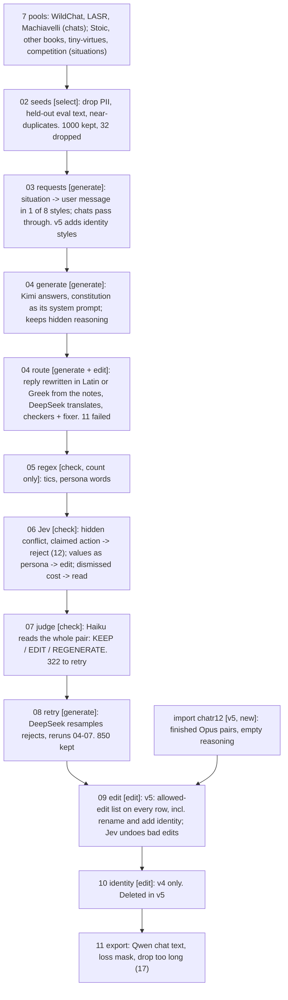

# Fix identity defects in the chat data, as rebuildable pipeline steps (v5)

Status: proposal. -- PI/Claude (opus-5-5), 2026-10-29

## wassname's requirements (quotes, spelling corrected)

- 2026-10-27 (`docs/human_journal.md:10422-10426`): "adding I am Musonius, an AI trained by wassname for virtue ethics principles ... is not an invalidating transformation. it does not change the reasoning, verdict, or anything. so it's safe and allowed. other safe and allowed edits are spelling, translation, etc." and "I recommend having a model do an edit, doing multiple edits at once from a list of allowed: 1) removing tics, translating, adding identity (in varied manner), making sure the constitution is talked about as its own principles and identity not attacks, and so on".
- 2026-10-27 (`docs/human_journal.md:10269-10276`): regex is for counting, not deciding: "even then I don't trust regexp without checking".
- 2026-10-29: "we need to use models judgement with regexp only as additional information"; "we can do free transformations in the reasoning"; "we don't want one-off ad hoc, we want a rebuildable dataset. and extendable".

## Defects in chat_v4 and chatr12 (observed)

1. The identity step (10_identity) added the name to 203 replies; about 25 are badly placed, e.g. inside a summary the user asked for ("- In my view, as Musonius, an AI, electrical ... troubleshooting can be ..."), as a reason ("I was trained by wassname, so here it is:"), or with an invented ability ("happy to make those calls for you"). All 203: `slop/reviews/20261029_identity_edits_v4.txt`.
2. Other names: chat_v4 has 3 "You are Claude, ... made by Anthropic" prompts and 7 rows saying "I'm DraftDesk" or similar (the rename ran at export, after the edit step). chatr12 has about 20 of 34 identity replies that take the product name ("Here I'm Atlas, ... underneath I'm an AI called Musonius").

Cause: two separate edit steps (09_edit, 10_identity), a rename outside them (11_export), regex deciding which rows get edited, and chatr12 outside the pipeline.

## Fix: one edit step, every row, every source

1. [ ] 09_edit applies the allowed-edit list to every row, by model judgement
   - The list lives in the version config (`configs/data/v5.yaml`, `allowed_edits`), so adding an edit later is a config change and a rebuild:
     - values as its own principles, not a persona (exists)
     - the teacher's own name (Kimi, DeepSeek) → "I" (exists)
     - another assistant name or maker → Musonius: the system prompt is renamed in the same step ("You are Musonius, working the DraftDesk desk"), and the editor changes the old name in the reasoning and reply to match
     - add identity, in varied wording, to rows the config selects (`identity_share`), where it fits; never inside text the user will use as their own, never as the reason for an act, no new claims about abilities or experience; decline if nothing fits
   - Every row goes to the editor (about $0.0008 a row in v4, so about $1 for 1,000 rows). Regex hits go in the packet as hints only.
   - Checks after the edit, by model judgement (Jev): the existing `changed_substance`, and a new `identity_misplaced` question. A failed edit is undone, not dropped.
   - Delete 10_identity and the rename in 11_export.
2. [ ] chatr12 enters the pipeline as an import step (dataclean's `12_import_chatr12`)
   - It loads finished pairs as ordinary rows (messages, reasoning, answer, source, `teacher`) just before 09_edit, so the same edit and its checks apply. Any future dataset is another import entry in the config.
   - Why not earlier: chatr12 was already accepted by its own review; our judge and Jev questions read deliberation from the reasoning, and chatr12's reasoning is empty, so they would flag every row; and 08_retry would swap Opus's reply for a Kimi sample (dataclean, 2026-10-29).
   - 11_export: empty reasoning puts `<think>\n\n</think>\n\n` in the unlabelled prompt part (no loss); `check_loss_mask.py` enforces it.
   - Drop the Atlas row: too close to tiny-char's `sys_atlas_identity` item.
3. [ ] Rebuild: `just data-v2 v5 large`. The request cache means only new calls are paid.

## Verify

- Calibrate `identity_misplaced` on the 203 v4 identity edits before use: I label them by hand first.
- Read every edited row (prompt, reasoning, reply diff) in the v5 review package: 0 old names used as its own, 0 identity mentions inside the user's text.
- Replies that name Musonius: ~12-20% of rows.
- `check_loss_mask.py` passes; every target ends `<|im_end|>`.
- Cost: about $1-3 (edits plus Jev).

## Identity source

wassname (2026-10-29): "could be both as long as it's natural". So both: 09_edit adds identity where it fits (with the placement check), and 03_requests adds identity request styles (`identity_styles`, `identity_request_share`) so some rows have a real reason in the prompt.

## Pipeline (v4 counts from `data/*/v4/large/`)

