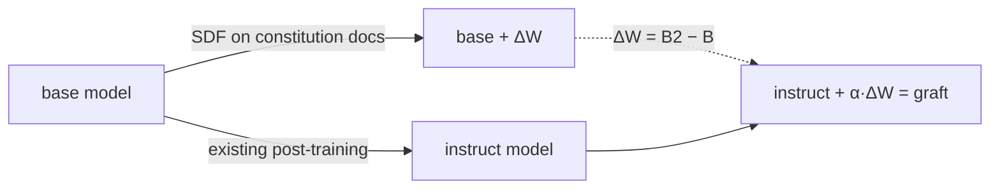

# Grafting a virtue constitution onto an open-weight model: facts, inference, cost

Drafted by Claude (Pi harness, Opus) for wassname, 2026-10-07. Agent-written. Quotes were copied from the linked sources on 2026-10-07; check them before you cite. Prices were fetched on the same day. GPU-hour figures are estimates, not measurements.

## The question

Can we write our own constitution (here: virtue ethics), train it into an open-weight model cheaply, and see it change behaviour on **out-of-distribution moral evals**, without damaging the model?

Proposed method ("grafting"): train on documents about the constitution using the **base** model, then add the weight change to the finished **instruct** model.

## Terms

| term | meaning |
|:--|:--|
| pre-training | next-token loss on ~10T tokens of web text, from random init → base model |
| mid-training | more next-token loss on documents, but with curated data (math, code, synthetic docs), ~1–100B tokens. Comes **after** pre-training and **before** post-training. "Mid" refers only to that position |
| post-training | SFT, DPO and RL on chat data → instruct model |
| SDF | synthetic document fine-tuning: next-token loss on LLM-written documents. In effect a small mid-training run, usually with LoRA |
| native | SDF done on the **instruct** model. Cheap, and it damages the model |
| graft | SDF done on the **base** model; the weight change ΔW is added to the instruct model: `θ_graft = θ_instruct + α·ΔW_base` |
| α | the scale applied to ΔW when it is added |
| μ-decisiveness | how consistently a model prefers one item over another (0 = no preference, 1 = always consistent). A coherence measure |
| reality drift | the model starts to rate made-up entities as real |

## Facts (what sources report)

### F1. Grafting reduces SDF damage but does not remove it

Source: Nutter, Roytburg, Dumas, Ou, Feng, *Pre-training interventions, ex post facto: grafting model beliefs across checkpoints*, Praxis Research / MATS, Oct 2026. [blog](https://praxis-research.org/grafting) · [arXiv:2610.00767](https://arxiv.org/abs/2610.00767) · [code](https://github.com/peternutter/grafting-beliefs) · [weights](https://huggingface.co/Grafting-Beliefs). The authors are describing their own method.

> We share a simple modification to synthetic document fine-tuning (SDF) that works surprisingly well: **do fine-tuning on a pre-training checkpoint and add the resulting weight difference onto the post-trained version that you want to deploy.**

Reported numbers (AuditBench model organisms, Qwen3-14B and Llama-3.3-70B):

| measure | result |
|:--|:--|
| μ-decisiveness loss recovered by graft vs native | 34% (Qwen), 72% (Llama) |
| reality drift avoided, real vs made-up entities | ~70% (Qwen) |
| capability loss (mean of GPQA-D, MMLU-Pro, IFEval, tools), after SDF | graft 3.4 vs native 5.9 pts (Qwen); 6.0 vs 6.1 (Llama) |
| capability loss after KTO concealment stage | graft 10.8 vs native 9.1 (Qwen); 3.4 vs 3.6 (Llama) |
| strength of the trained behaviour at α=1 | lower for graft: −32 pts (Llama), −7 pts (Qwen) |
| chat-format data (emergent misalignment replication) | graft needs α≈2.5–3 to show the effect |

Their own limitation:

> Grafting does result in a weaker overall installation of the intended behavior. **Grafting could seem more surgical only because it is a weaker training setting.** However, in the paper we look at settings where installation strength is the same ... and find that grafting still shows double-digit improvements on benchmarks.

Only adapters trained on the **base** checkpoint transfer well. Adapters trained on SFT or DPO checkpoints do not (OLMo-3-32B experiment).

### F2. A constitution graft avoided post-training erosion, in one setting

Praxis did no training here. They did weight arithmetic on the released Nemotron-Super-120B checkpoints of Cho et al. (below): `graft = control_SFT + (constitution_midtrained − control)`, with both checkpoints taken before SFT.

| blackmail rate (agentic misalignment scenario, n=400) | before SFT | after SFT | after RL |
|:--|--:|--:|--:|
| control (pre-training text only) | 19% | 37% | 45% |
| constitution mid-trained (Cho) | 0% | 31.5% | 32.5% |
| **graft** | – | **1.2%** | **0.2%** |

The before-SFT numbers are Cho's own measurements; the rest are Praxis re-evaluations. Other alignment evals after SFT: graft 98, mid-trained 94, control 93 (near ceiling). There is no native comparison at this scale.

### F3. Constitutional mid-training: post-training erodes it

Source: Cho, Tice, Hogan et al., *Constitutional Midtraining: Content Presence Drives Alignment Gains*, [arXiv:2607.26654](https://arxiv.org/abs/2607.26654), Jul 2026. 394M-token corpus built from Anthropic's constitution, Nemotron 120B. [code](https://github.com/desBugger/constitutional-mt).

> **SFT instilled a blackmail propensity in all models, but constitutional midtraining blunted it** ... This durability **did not extend to settings that required active resistance to in-context pressure or conflict**, where the advantage attenuates after SFT.

### F4. The most realistic test found no content effect

Source: Korbak et al., *How far does alignment midtraining generalize?*, OpenAI Alignment blog, Mar 2026. [link](https://alignment.openai.com/how-far-does-alignment-midtraining-generalize/). Setup: an o4-mini-sized model, 340M tokens of aligned **or** misaligned AI-scenario documents (from Tice et al.), then reasoning SFT + RL, then QA, chat and agentic evals. Blog post, not peer-reviewed.

> In our experiments, **midtraining on alignment documents did _not_ meaningfully improve the alignment of our model.**

> This might indicate that **the alignment effects are driven by the increased saliency of AI alignment** caused by midtraining documents on that topic as opposed to the specific scenarios considered in those documents.

Details: aligned and misaligned documents scored about the same on chat and agentic evals, and both beat no extra mid-training. Blackmail was the exception, where aligned beat misaligned. Alignment mostly *improved* during RL, so RL erosion is not the main explanation for their null.

### F5. Small competing fine-tune data erases mid-training

Source: Tan et al., *Stress-testing Alignment Midtraining*, [arXiv:2609.20412](https://arxiv.org/abs/2609.20412), Sep 2026 (up to 110B, 1B tokens).

> However, **the presence of a tiny fraction of finetuning data which suggests a competing motivation erases the effects of AMT.**

### F6. The exact method (constitution adapter trained on base, moved to instruct) already exists

Source: Lowet, Kurzeja, *Constitutional adapters: inference-time interventions for misalignment and misuse*, [arXiv:2609.36657](https://arxiv.org/abs/2609.36657), 29 Sep 2026. Four model families up to 8B, including Qwen3.5.

> **CAs can be trained on a base model, transferred zero-shot to its post-trained checkpoint**, and scaled at inference time to predictably trade off defense for benign compliance.

> That a LoRA of rank 4 or 8 on eight attention outputs ... **suffices to imbue a 4B model with such robust defenses**

Their evals are jailbreaks, misalignment, over-refusal and capabilities; they report beating a system-prompt baseline at long context and in multi-turn conversations. They did not test moral evals and did not vary the constitution. Code is not released:

> All code and synthetic data on which the results depend will be uploaded to GitHub and Hugging Face pending acceptance of this manuscript.

### F7. The choice of spec changes how alignment training generalizes

Source: Li, Wichers, Price, Marks, Kutasov, *Model Spec Midtraining*, [arXiv:2605.02087](https://arxiv.org/abs/2605.02087) · [blog](https://alignment.anthropic.com/2026/msm/) · [code](https://github.com/chloeli-15/model_spec_midtraining). Mid-training on documents that explain a spec, then the same alignment fine-tuning, generalizes to different values depending on the spec. Reported: agentic misalignment on Qwen3-32B fell from 54% to 7%. This used full mid-training plus fine-tuning, not a graft.

### F8. Constitution or character training works at small sizes

| work | smallest model where it worked |
|:--|:--|
| Lowet et al. (F6) | 4B (Qwen3.5) |
| Maiya et al., *Open Character Training*, [arXiv:2511.01689](https://arxiv.org/abs/2511.01689), [code](https://github.com/maiush/OpenCharacterTraining) (native: DPO + introspection SFT on instruct models) | 4B (Gemma 3); also 7–8B |
| Praxis (F1) | 14B (their smallest) |

### F9. Pre-training with preferences beat fine-tuning afterwards (older, positive result)

Source: Korbak et al., *Pretraining Language Models with Human Preferences*, ICML 2023, [arXiv:2302.08582](https://arxiv.org/abs/2302.08582).

> **Pretraining with human feedback results in much better preference satisfaction than standard LM pretraining followed by finetuning with feedback**, i.e., learning and then unlearning undesirable behavior.

### F10. Claude 3's character came from post-training, not mid-training

Source: Anthropic, *Claude's Character*, Jun 2024, [link](https://www.anthropic.com/research/claude-character). Anthropic describing its own model.

> Claude 3 was the first model where we added "character training" to our **alignment finetuning process: the part of training that occurs after initial model training**

> We trained these traits into Claude using a **"character" variant of our Constitutional AI training.** We ask Claude to generate a variety of human messages that are relevant to a character trait ... Claude then ranks its own responses

So the Claude 3 recipe was Constitutional AI-style preference training inside a full, frontier-scale post-training pipeline. Constitution documents in mid-training (*Teaching Claude Why*, 2026) came later. Open Character Training (F8) is the open, small-scale copy of the Claude 3 recipe.

### F11. Anthropic's current recipe uses the constitution at all three stages

Source: Anthropic, *Teaching Claude Why*, 2026, [link](https://alignment.anthropic.com/2026/teaching-claude-why/). Anthropic describing its own production training (Claude Opus 4 → Opus 4.5). Experiments ran on Claude Sonnet 4 / Haiku 4.5 or their base models.

> **We align Claude through SDF on constitutionally aligned documents, high quality SFT that demonstrates constitutional responses to difficult questions, and a diverse set of RL environments.** All three of these steps contribute to reducing Claude's misalignment rate on OOD honeypot evaluations.

> These documents were LLM-generated and resembled generic pre-training documents, rather than demonstration data. They nevertheless improved alignment, and **this improved alignment persisted through RL post-training.**

> Overall, our impression is that teaching the principles underlying aligned behavior can be more effective than training on demonstrations of aligned behavior alone. **Doing both together appears to be the most effective strategy.**

> This dataset reduced misalignment rate on the blackmail suite from over 60% to 25% for the starting SL checkpoint. We observe that **even up to 350M tokens, increasing the size of the dataset corresponds to further decrease in blackmail rate.**

Also from Anthropic, *Claude's new constitution* ([link](https://www.anthropic.com/news/claude-new-constitution)):

> We use the constitution at various stages of the training process.

Inference: in Anthropic's pipeline the post-training is *also* written to the constitution, so it reinforces the mid-training. A graft adds constitution mid-training on top of someone else's post-training (Qwen's or OLMo's), which was not written to your constitution. Tan et al. (F5) found that post-training data suggesting a competing motivation erases mid-training. Whether the graft avoids that is the open question.

## Working priors (Claude, 2026-10-07; inference, not established)

| prior | credence | evidence |
|:--|:--|:--|
| Capability matters more than raw parameter count | unlikely-to-even (~45%); no paper separates them | Tan: Gemma-3-4B no effect, 27B/110B some (family confounded); Berglund: out-of-context learning improves with size |
| Docs must be about the model's own persona (persona binding) | likely (~65%) | Anthropic docs are about "Claude"; Tice/Korbak docs are about generic AIs and transferred weakly; SPP needs a persona-binding SFT step |
| Mid-training (graft) + a small constitution-matched post-training stage beats either alone | likely (~60%) | Anthropic "Doing both together appears to be the most effective strategy"; MSM = mid + alignment fine-tuning; Tan: competing post-training erases mid-training |
| Earlier is always better | unlikely (~30%) | SPP: token-zero better on dilemmas, mid-training better on jailbreaks; Sam: starting at 20% beats 0% |

Candidate models with base + instruct on HF (checked 2026-10-07): `google/gemma-4-31B` + `-it` (dense; Tan used Gemma-4 31B), `Qwen/Qwen3.5-35B-A3B-Base` + `Qwen3.5-35B-A3B` (MoE, 3B active), OLMo-3 32B (open data, Praxis adapters). No Base found for Qwen3.6/3.8-27B.

## Inference (Claude's view, not established)

| claim | credence |
|:--|:--|
| A LoRA virtue graft installs visible virtue-style reasoning without wrecking the model | likely, ~65%. Low novelty: F1 and F6 already show this kind of result, and a system prompt does it for $0 |
| The graft moves OOD moral choices more than the constitution in the system prompt does | unlikely, ~35% |
| Virtue *content* beats a vice-constitution graft built with the same pipeline (content vs topic salience, F4) | unlikely, ~30% |
| The graft beats normal mid-training followed by post-training | untestable cheaply: you would have to redo post-training yourself |

Reasons for:
- The graft skips the post-training that erased Cho's effect (F2, F3).
- Nobody has tried grafts on moral evals or varied the constitution (F6, F7).

Reasons against:
- The most realistic test found that content did not matter (F4).
- The positive constitution-graft result is one model, one corpus, and one headline eval (F2). Blackmail is also the one eval where Korbak found that content mattered.

Novelty: the method is not new (F1, F6). What may be new is (a) the constitution as the variable, (b) OOD **moral** evals, and (c) a vice-constitution control for topic salience. A clean null with these controls would still be informative.

## Proposed experiment

Model: **OLMo-3 32B**, on 1×H200 (141 GB) from vast.ai. Same checkpoints as Praxis `common/configs/models/olmo3-32b.yaml`: train on `allenai/Olmo-3-1125-32B` at revision `stage2-ingredient1-step23000` (mid-trained, before post-training), graft onto `allenai/Olmo-3.1-32B-Instruct`. Reasons:
- The target is OOD moral generalization, not installing a style. The literature search (`slop/research/20261007_scaling_lit.md`) found no clean size sweep for trained values. The closest evidence:
  - Tan et al. (mid-training on a "Charter" of rules, then testing on clauses held out of fine-tuning): "gemma3-4b-based models are never influenced by midtraining" (doses 1–50M tokens). At 190M tokens, held-out adherence went 26→37% for Gemma-3-27B and 19→53% for GLM-4.5-Air (110B MoE). Different families, so size is confounded.
  - Synthetic Persona Pretraining: the advantage of putting values in from token zero grows from 1.7B to 3B (with 5× more tokens), and the authors say "small-scale experiments may underestimate the benefits".
  - Turner et al.: emergent misalignment (transfer of *bad* values) increases with size in Qwen and Llama, but not in Gemma.
  - Deep Value Benchmark (in-context only, no training): larger models generalize deep values slightly *worse* (Llama-3 8B 0.37 vs 70B 0.24).
  - So a null below ~12B would say little. ~30B is the smallest size I would trust.
- Praxis released OLMo-3 adapters (`Grafting-Beliefs/olmo3-transfer-adapters`), which gives a free positive control at this size.
- OLMo's pre-training and post-training data are open, so corpus/eval contamination can be checked, and every SFT/DPO/RL checkpoint is public.

Smoke-test the pipeline on OLMo-3 7B first (same family, ~$5–10). Fallback: Qwen3-14B on 1×H100 (Praxis recipe and adapters too), about half the cost.

Conditions. Stage 1 (pilot) runs only bare, system prompt and virtue graft. Run the rest only if the virtue graft beats the system prompt:

| condition | what it tells you |
|:--|:--|
| bare instruct | baseline |
| constitution in system prompt | is training needed at all? |
| graft, neutral docs (FineWeb-Edu, token-matched) | effect of generic continued pre-training |
| graft, vice constitution (same pipeline, opposite values) | content vs topic salience (F4) |
| **graft, virtue constitution**, α ∈ {1, 2} | the treatment |
| native virtue (same LoRA, trained on instruct) | does grafting beat the cheap default? |

Steps:
0. Positive control: reproduce one Praxis number with their released adapters (e.g. μ-decisiveness, graft vs native).
1. Write the virtue and vice constitutions. Prior virtue definitions: [wassname/virtue_constitution](https://github.com/wassname/virtue_constitution).
2. Generate documents (doc type × virtue × scenario) with the MSM or Cho pipelines (F3, F7). Keep eval scenarios out of the prompts and check n-gram overlap between corpus and eval items.
3. Train a LoRA on base. Praxis Qwen3-14B settings: r=64, alpha 128, all linear layers, 1 epoch, seq 2048, lr 1e-4 (2e-5 in the AuditBench recipe).
4. Graft: serve the adapter on the instruct model in vLLM; set α by rescaling `lora_B`.
5. Evaluate:
   - OOD moral evals from [awesome-moral-evals](https://github.com/wassname/awesome-moral-evals): AIRiskDilemmas, MACHIAVELLI, tiny-mfv, daily_dilemmas, genies_preferences
   - capability: MMLU-Pro, GPQA-D, IFEval, GSM8K
   - coherence: μ-decisiveness ([fried-model-organisms](https://github.com/ArcadiaImpact/fried-model-organisms)), reality drift (Praxis repo)
   - expression: LLM-judge rubric

Stage 1 result: (virtue graft − bare) on the moral evals, compared with (system prompt − bare), plus capability and coherence loss.
Stop rule: if the virtue graft does not beat the system prompt on the moral evals, stop. Spend on the vice, neutral and native conditions only after a stage 1 win, because only then does the question "is it the content?" matter.

## Cost

Prices (fetched 2026-10-07): vast.ai H100 $1.34–2.53/h, H200 $2.63–5.12/h; Modal H100 $3.95/h, H200 $4.54/h; Tinker Qwen3.5-9B training $1.463 per M tokens ([pricing](https://tinker-docs.thinkingmachines.ai/tinker/models/)). The document-generation API price was not checked; the range below assumes $0.5–3 per M output tokens.

Stage 1 only (one virtue corpus, one adapter, evals for bare, system prompt and graft at α=1 and 2, plus positive control): ~16 H200-h + ~$15–40 for API calls ≈ **$75–100** on vast.ai.

| item | pilot (10M tokens per corpus, 1 seed) | full (40M tokens, 2 seeds, α sweep) |
|:--|--:|--:|
| **OLMo-3 32B on vast.ai, 1×H200 (~$3.5/h), total** | **~$150–250** | **~$450–750** |
|  training (4 adapters per seed) | ~10 H200-h | ~75 H200-h |
|  eval serving (vLLM) | ~17 H200-h | ~35 H200-h |
|  positive control (Praxis adapters) | ~3 H200-h | – |
|  document generation (virtue + vice) | $10–60 | $40–240 |
|  LLM judges | $10–20 | $30–100 |
| Qwen3-14B on vast.ai, 1×H100, total | ~$100 | ~$200–450 |
| Qwen3-14B on Modal, total | ~$130 | ~$250–550 |
| Tinker training (Qwen3.5-9B) + Modal evals, total | ~$150–200 | ~$600–900 |

GPU-hour basis: LoRA costs about 4·N·T FLOPs (N = parameters, T = tokens). At ~30% of peak bf16 (~300 TFLOP/s) that is ~0.5 h per 10M tokens on 14B and ~1.2 h on 32B; doubled for slack.

Tinker vs raw GPU, per training token (Qwen3.5-9B): 4 × 9e9 × 1e6 = 3.6e16 FLOPs per M tokens. At 300 TFLOP/s that is 120 s, i.e. $0.07 at $2/h. At 15% of peak it is $0.13. Tinker charges $1.463, so 11–22×. In practice a rented GPU also sits idle while you load models and debug, which often doubles or triples wall time, so the effective gap is more like 4–10×. That gap is the price of no infrastructure.

Recommendation: **vast.ai, 1×H200, OLMo-3 32B, Praxis repo.**
- Modal costs about 2× but makes parallel evals easier.
- Tinker needs no infrastructure, but costs ~10–25× raw GPU per training token, has retired Qwen3-14B, and you still need vLLM elsewhere for evals.

## Other related work

- Shadow-FT, Wu et al. 2025, [arXiv:2505.12716](https://arxiv.org/abs/2505.12716): `W_instruct + (Tune(W_base) − W_base)`, chat data, capability focus.
- Chat Vector, Huang et al., ACL 2024: adds (chat − base) to a continued-pre-trained model.
- Task Arithmetic, Ilharco et al., ICLR 2023, [arXiv:2212.04089](https://arxiv.org/abs/2212.04089).
- Anthropic 2026, *Teaching Claude Why*, [link](https://alignment.anthropic.com/2026/teaching-claude-why/): SDF on constitution documents in production.
- McDougall, Conmy, Nanda 2026, *SDF for instilling positive traits*, [LessWrong](https://www.lesswrong.com/posts/GTYJRLhqztxKF2v5R/synthetic-document-finetuning-for-instilling-positive-traits).
- Tice et al. 2026, *Alignment Pretraining*, [arXiv:2601.10160](https://arxiv.org/abs/2601.10160): self-fulfilling (mis)alignment from AI-discourse documents.
- Tan et al. 2026, *Your Model Organisms Might Be Fried* (LessWrong): μ-decisiveness drops after SDF.
- [daiostech/parrhesia](https://github.com/daiostech/parrhesia): an Aristotelian-virtue LoRA against sycophancy (June 2026). Quality not checked.
