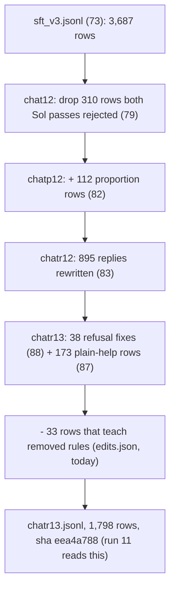

# Chat data pipeline: is it repeatable? (review, 2026-10-24)

Current proposal: `slop/plans/20261024_dataset_pipeline.md`. Correction by PI/Sol: reusing script 76 at different stages does not itself prove a DAG cycle; nodes are invocations/artifacts. The confirmed gaps are unconnected operations, hard-coded dataset paths and incomplete review identity. The older proposal below is retained as working history, not the implementation plan.

wassname (2026-10-24, spelling corrected): "dataset building should be repeatable not ad hoc".

## Bottom line

There are two kinds of "repeatable". We have the first and not the second.

| kind | question | status |
|:--|:--|:--|
| **rebuild** | From the saved inputs, do we get the same training files? | **yes.** `just run10-data` reruns every builder and fails if any sha in `data/train/run10/manifest.json` changes. |
| **re-run a fix** | When the constitution changes or some replies need redoing, can we put rows through the same steps again with one command? | **no.** Each fix was a one-off: its own script, its own hand-run review, its own accept list, and a new block of code in `76` that makes a new file name. |

So the problem is not that the files can't be rebuilt. It is that every change so far added a new layer by hand, and the layers do not check each other.

## How the current chat set is built

Each arrow is one script, one two-reviewer Sol pass run by hand from Pi, one `joined.json` accept list, and one more block in `scripts/data/76_run10_train_files.py`.



## Problems, with where they are

| # | problem | evidence | what can go wrong |
|:--|:--|:--|:--|
| 1 | Each fix step reads the previous step's output file by name. | `83_rewrite_replies.py:64` reads `chatp12.jsonl`; `88_fix_refusals.py:69` reads `chatr12.jsonl`; `78_fresh_review.py:29` reads `chat12.jsonl` | The order of steps is fixed in file names. A new fix means a new name (chatr14) and more code in 76. |
| 2 | A replacement reply is matched by row id only. | `76:80` and `76:89`: `{"text": new[r["id"]]}` | If an earlier step changes a reply, a later fix that was written from the old reply still overwrites it, without warning. |
| 3 | Accept lists are not tied to the exact text they accepted. | accept lists in `slop/reviews/*/joined.json` (in git); replies in `data/frontier/*/items.jsonl` (not in git, opened in append mode: `80:95`, `83:101`, `87:52`) | Re-running a generator appends new text under the same id. Which text the reviewers accepted is not pinned. |
| 4 | A missing input is silently skipped. | `76:45`: `jl(edits) if edits.exists() else []`. `data/frontier/fresh_loop/edits.jsonl` does not exist; the build prints "fresh-loop edits applied: 0/0". `screen_fix_log.jsonl` (1.9 MB, 2026-10-21) is there. | I checked: the log holds 1,184 one-sentence edits; for 1,145 the old text is still in `chat.jsonl`, so none were applied. They were probably replaced by the two-pass Sol drop of 310 rows (journal line 2325), but the code still tries to load the file and says nothing. |
| 5 | Nothing flags rows written against an old constitution. | `80` records `constitution_sha` per reply; nothing reads it. | Today's constitution edits made some rows wrong. I found them with regex searches by hand. |
| 6 | The two-reviewer passes are run by hand. | `justfile:53-63`: "Steps 2 and 4 are subagent workflows run from Pi" | The checks a row must pass are not one command, so a new reply may skip one. |
| 7 | Old sets are rebuilt with the current one. | 76 rebuilds chat12, chatgen12, chatp12, chatr12 each time | A change meant for the current set can change a past set's file. The manifest check catches this, so this one is a cost, not a hole. |

## Proposal: a DAG with semantic paths

wassname (2026-10-24): "repeatable, code, checked in. like a DAG with semantic paths?" Yes. This replaces my first idea (a change log), which was one more patch layer.

**Why today's steps are not a DAG.** 76 writes every chat set in one run, and later steps read 76's output: 83 reads `chatp12.jsonl`, 76 then reads 83's rewrites to make `chatr12`; 88 reads `chatr12.jsonl`, 76 then reads 88's fixes to make `chatr13`. At the file level, 76 is both before and after 83 and 88, so the order exists only in whoever ran them.

**The DAG.** Each step is one checked-in script with one input file and one output file, and the folder name says the step and order:

```
data/chat/
  00_base/rows.jsonl            73: frozen Qwen chats + identity rows
  10_review/verdicts.jsonl      two Sol passes, accept/reject per row
  11_kept/rows.jsonl            rows not rejected by both
  20_proportion/rows.jsonl      + reviewed proportion rows
  30_rewrite/replies.jsonl      step-6 rewrite of 20 (model calls)
  31_rewrite_review/verdicts.jsonl
  32_rewritten/rows.jsonl       accepted rewrites applied
  40_refusal_audit/labels.jsonl
  41_refusal_fix/replies.jsonl  (+ 42 review, 43 rows)
  50_plain_help/rows.jsonl
  60_rule_check/rows.jsonl      drops rows that teach removed rules (phrase list checked in)
  90_mix/chat.jsonl             identity sampled to 12% of words; this is what adapters train on
```

Rules for every step:

1. **Model calls are cached by prompt hash.** Re-running a step with the same input and prompt reads the cache: same bytes, no cost. A new input row or a changed prompt makes a new call for that row only.
2. **Review steps are nodes too.** A step that needs Sol verdicts reads `verdicts.jsonl` keyed by the hash of the reply text. If a verdict is missing, the step stops and lists the replies that need review. Then the reviews run (script or Pi workflow) and the step is re-run. Nothing is joined by id alone, so a reply that changed upstream cannot take an old verdict or an old fix.
3. **No silent skips.** A missing input file is an error.
4. **One command** (`just chat`) runs the steps in order and checks the final sha against the manifest.
5. **The constitution is a pinned input.** Each generating step names the constitution sha it uses. Changing the constitution does not redo every reply by itself. You choose which steps to re-run with the new version, and the cache redoes only rows whose prompt changed.

**Past sets.** chat12 to chatr13 stay as records, cited by sha. The first job is to show the DAG reproduces today's `chatr13.jsonl` byte for byte (sha eea4a788) before any step changes.

## Decisions needed (wassname)

- **Reviews as scripts or as Pi subagents?** Sol reviews have been Pi subagent workflows (subscription, no API cost). A script calling an API costs money each run but can be repeated with one command. A middle path: keep the subagent, but make the check command write the exact review package and read back the verdict file, so the step is fixed even though it runs in Pi.
- **The fresh-loop edits (problem 4).** Did you mean to drop them? If yes, I delete the dead code in 76. If not, they go into the change log like any other fix and get reviewed.
- **Name for the current set.** `data/chat/90_mix/chat.jsonl` from now on; `data/train/run10/chatr13.jsonl` stays as the record run 11 used.

-- PI/Claude (claude-opus-5-5)
