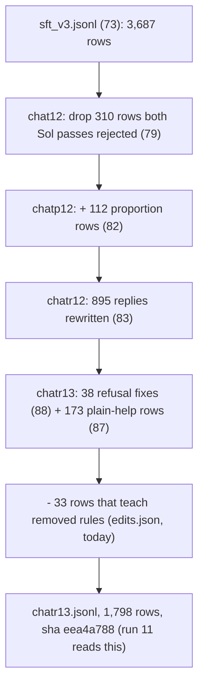
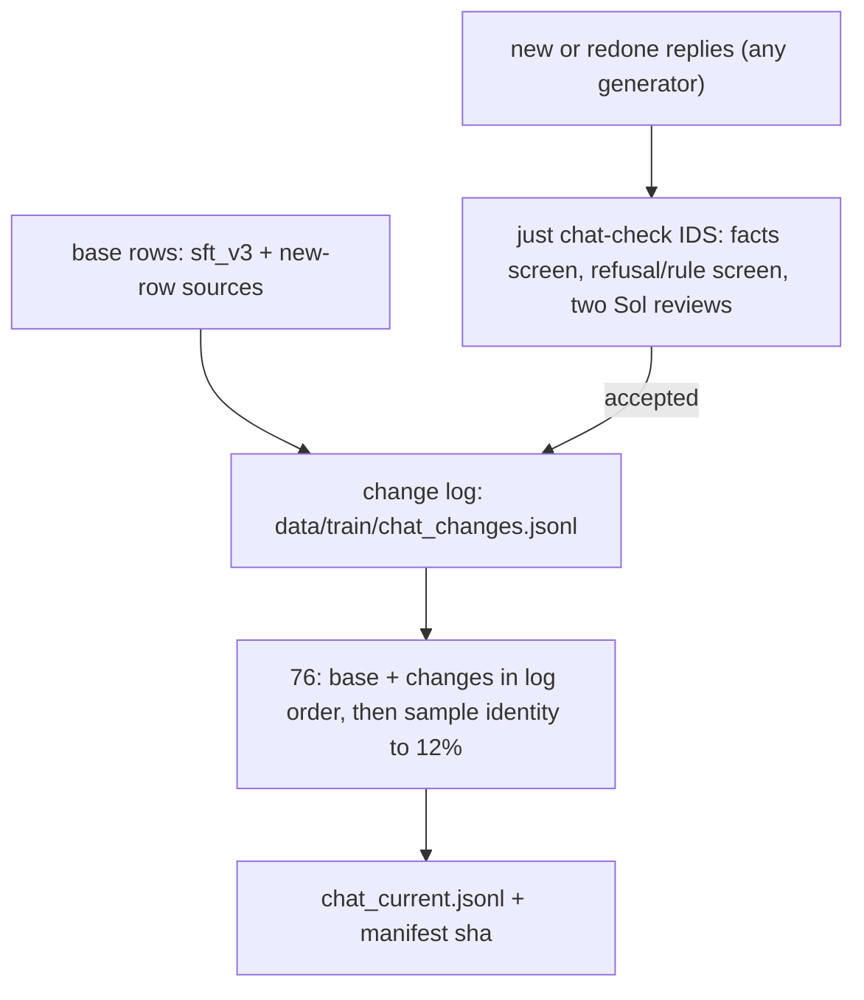

# Chat data pipeline: is it repeatable? (review, 2026-10-24)

wassname (2026-10-24, spelling corrected): "dataset building should be repeatable not ad hoc".

## Bottom line

There are two kinds of "repeatable". We have the first and not the second.

| kind | question | status |
|:--|:--|:--|
| **rebuild** | From the saved inputs, do we get the same training files? | **yes.** `just run10-data` reruns every builder and fails if any sha in `data/train/run10/manifest.json` changes. |
| **re-run a fix** | When the constitution changes or some replies need redoing, can we put rows through the same steps again with one command? | **no.** Each fix was a one-off: its own script, its own hand-run review, its own accept list, and a new block of code in `76` that makes a new file name. |

So the problem is not that the files can't be rebuilt. It is that every change so far added a new layer by hand, and the layers do not check each other.

## How the current chat set is built

Each arrow is one script, one two-reviewer Sol pass run by hand from Pi, one `joined.json` accept list, and one more block in `scripts/data/76_run10_train_files.py`.

## Problems, with where they are

| # | problem | evidence | what can go wrong |
|:--|:--|:--|:--|
| 1 | Each fix step reads the previous step's output file by name. | `83_rewrite_replies.py:64` reads `chatp12.jsonl`; `88_fix_refusals.py:69` reads `chatr12.jsonl`; `78_fresh_review.py:29` reads `chat12.jsonl` | The order of steps is fixed in file names. A new fix means a new name (chatr14) and more code in 76. |
| 2 | A replacement reply is matched by row id only. | `76:80` and `76:89`: `{"text": new[r["id"]]}` | If an earlier step changes a reply, a later fix that was written from the old reply still overwrites it, without warning. |
| 3 | Accept lists are not tied to the exact text they accepted. | accept lists in `slop/reviews/*/joined.json` (in git); replies in `data/frontier/*/items.jsonl` (not in git, opened in append mode: `80:95`, `83:101`, `87:52`) | Re-running a generator appends new text under the same id. Which text the reviewers accepted is not pinned. |
| 4 | A missing input is silently skipped. | `76:45`: `jl(edits) if edits.exists() else []`. `data/frontier/fresh_loop/edits.jsonl` does not exist; the build prints "fresh-loop edits applied: 0/0". `screen_fix_log.jsonl` (1.9 MB, 2026-10-21) is there. | I checked: the log holds 1,184 one-sentence edits; for 1,145 the old text is still in `chat.jsonl`, so none were applied. They were probably replaced by the two-pass Sol drop of 310 rows (journal line 2325), but the code still tries to load the file and says nothing. |
| 5 | Nothing flags rows written against an old constitution. | `80` records `constitution_sha` per reply; nothing reads it. | Today's constitution edits made some rows wrong. I found them with regex searches by hand. |
| 6 | The two-reviewer passes are run by hand. | `justfile:53-63`: "Steps 2 and 4 are subagent workflows run from Pi" | The checks a row must pass are not one command, so a new reply may skip one. |
| 7 | Old sets are rebuilt with the current one. | 76 rebuilds chat12, chatgen12, chatp12, chatr12 each time | A change meant for the current set can change a past set's file. The manifest check catches this, so this one is a cost, not a hole. |

## Proposal

Goal: one place records every change to a reply, one command runs every check, and the build refuses inputs it can't verify.

1. **One change log.** Each line is one change to one row:
   `{id, action: replace|drop|add, text_sha, base_sha, step, constitution_sha, review: <file>, verdicts}`.
   `base_sha` is the sha of the reply the change was made from. Reply texts live in one store keyed by `text_sha`.
2. **The build checks everything.** 76 applies the log in order. It stops if a `base_sha` doesn't match the current reply (fixes problem 2), if a `text_sha` is missing from the store (problems 3 and 4), or if any training row contains a phrase on the removed-rules list (catches the kind of thing we found today, problem 5).
3. **One check command.** `just chat-check IDS` runs the same screens and the two reviews on any new reply and writes accepted changes to the log (problem 6). Everything is a script, so the same rows give the same verdict files.
4. **Past sets are frozen.** chat12 through chatr13 are records by sha (the recipes table cites them). Builds stop regenerating them. `just run10-data` still checks they reproduce from git history if needed.
5. **First step, before anything else changes:** convert the existing layers into log entries and show that the new build gives today's `chatr13.jsonl` byte for byte (sha eea4a788, 1,798 rows). Run 11's lease uses those bytes.

## Decisions needed (wassname)

- **Reviews as scripts or as Pi subagents?** Sol reviews have been Pi subagent workflows (subscription, no API cost). A script calling an API costs money each run but can be repeated with one command. A middle path: keep the subagent, but make the check command write the exact review package and read back the verdict file, so the step is fixed even though it runs in Pi.
- **The fresh-loop edits (problem 4).** Did you mean to drop them? If yes, I delete the dead code in 76. If not, they go into the change log like any other fix and get reviewed.
- **Name for the current set.** `chat_current.jsonl` with its sha in the manifest, or keep `chatr13` for now and change the name after run 11.

-- PI/Claude (claude-opus-5-5)
